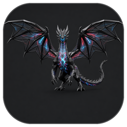

# The app icon

The icon is the whole dragon, wings spread, on a dark rounded tile. It is an AI redraw of the project's dragon art
(the same art as the banner), made at 1024 px, with the floating shards of the original left out.

## Files

`etc/images/icon/drgnx-N.png`, one per size, each downscaled from the 1024 px master:

| Size | Used for |
|---|---|
| 1024, 512, 256 | the large desktop and app-switcher icons, the macOS app icon source |
| 128, 64, 48 | launchers, the desktop entry |
| 32, 24, 16 | panels, title bars, tab lists: these three get a slight lift of brightness, saturation and contrast so the glow of the veins still reads |

The master is square with transparent corners; the tile's rounded edge is part of the picture, so never round or mask
it again.

## How it reaches the desktop

`drgnx service-unit --refresh` (and onboarding's service step) copies the files into the hicolor icon theme as `drgnx`
at 16, 24, 32, 48, 64, 128, 256, 512 and 1024 px, and an installed `drgnx.desktop` is given `Icon=drgnx`. See
[packages](../guide/packages.md). An icon you chose yourself in the entry is kept.

## Rules

- Use the PNGs as they are; there is no vector version, because tracing the painting bands and bloats. A hand-drawn
  one-colour silhouette for symbolic and menu-bar use may come later.
- The start page and the README show the banner art, not the icon.
- The icon's licence is the project's (GPL v3.0 or later, see the README), and its art is an AI redraw, which the README
  says.
