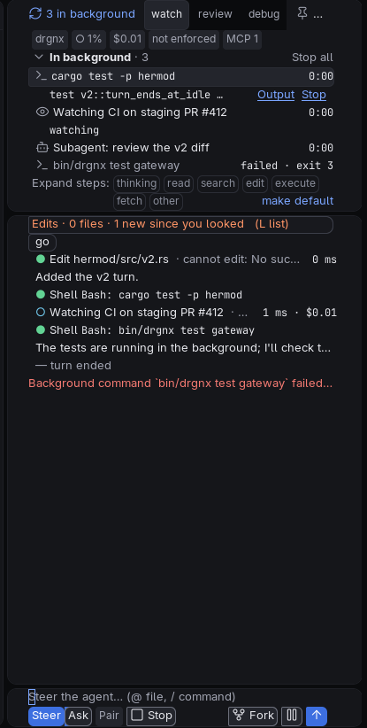
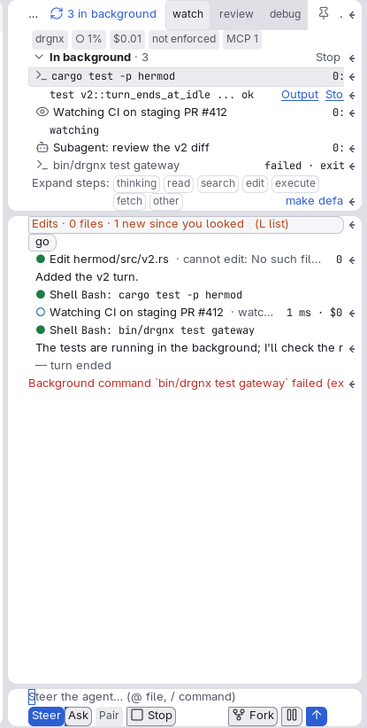

# Background list

What a chat leaves running between turns (ACP v2's list of shells, watchers and subagents, plus drgnx's own jobs), in
the agent panel: a count in the header, a list pinned under the chips, a live card in the transcript while an item
runs, and one line when it ends. The hub builds every row (`view/panel_top/background.rs`, `view/bgwork.rs`); Emacs
only keeps the elapsed cells ticking and runs the commands.

## Anatomy

- **Chip** in the header row, right of the status: `⟳ 3 in background` in the accent colour, hidden while nothing runs;
  `2 · state unknown` in the warning colour while the agent reports `unknown` (nothing is shown as done that the agent
  did not say). A click folds or unfolds the list.
- **Head** of the list: chevron, "In background · N" and, while anything can be stopped, "Stop all" at the right.
- **Row** per item: its kind's Lucide icon (`terminal`, `eye`, `bot`), the description (the code font for a command),
  the elapsed time `m:ss` at the right; under it the last output line, muted, in the code font. The selected row (`b`
  moves the selection, a click selects) shows **Output** (**Open** for a subagent) and **Stop** at the right of that
  line; Stop only where the item's agent lets a client stop it, never disabled.
- At most six rows; the rest are "and N more", which picks one.
- An item that ended stays faded for a few seconds with how it ended ("failed · exit 101"), until its line is in the
  transcript, then leaves.
- In the transcript: a tool call that started an item draws live (the run dot, "in background", elapsed time); an end is
  one line ("Background command `CMD` failed (exit 3) · 4 min", with Output); a turn the agent started by itself after
  an end carries an "after: DESCRIPTION" tag.
- On a terminal the same rows in characters: `R $ COMMAND  4:12`, status letters R running, F failed, D done, S
  stopped, ? unknown, kind marks `$` shell, `◉` watcher, `@` subagent.

## Faces and tokens

The rows use the panel's faces: `drgnx-agent-panel-chip` and the accent for the chip, `drgnx-agent-panel-warn`,
`drgnx-agent-panel-subtle`, `drgnx-agent-panel-code` and `drgnx-agent-panel-md-link` for the actions. No colour of its own.

## Rules

- No hover reveal: the actions show on the selected row (redrawing on mouse movement is not worth it).
- Never a row or a chip for an agent that reports no list (a v1 agent); drgnx's own jobs still list.
- The mockup is `docs/specs/drgnx/the-look/agent-background.html`.
