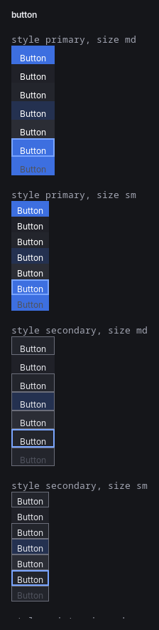
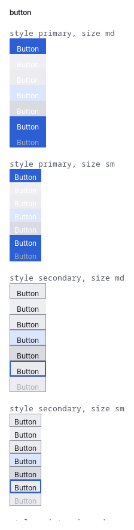
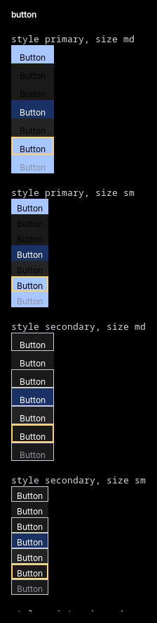

# Button (kit)

<!-- Generated by `bin/drgnx design` from etc/ui/components.eld. Do not edit; change the source and regenerate. -->

The kit's `button` component: one definition in `etc/ui/components.eld`, expanded the same way by the hub (`drgnx_rows::kit`) and by the Lisp chrome (`drgnx-ui-kit-expand`). Sizes are logical pixels; every colour is a [token](../tokens.md). Open it live with **Design: Component Catalogue**.

## Variants

- `style`: `primary`, `secondary`, `quiet`, `danger` (default `secondary`)
- `size`: `md`, `sm` (default `md`)

## Geometry

| Variant | Density | Height | Pad (start / end) | Gap | Box | Radius | Hit | Indent |
|---|---|---|---|---|---|---|---|---|
| primary md | compact | 26 | 12 / 12 | 6 | yes | 6 | 4 | - |
| primary md | comfortable | 26 | 12 / 12 | 6 | yes | 6 | 4 | - |
| primary md | roomy | 26 | 12 / 12 | 6 | yes | 6 | 4 | - |
| primary sm | compact | 22 | 8 / 8 | 6 | yes | 6 | 4 | - |
| primary sm | comfortable | 22 | 8 / 8 | 6 | yes | 6 | 4 | - |
| primary sm | roomy | 22 | 8 / 8 | 6 | yes | 6 | 4 | - |
| secondary md | compact | 26 | 12 / 12 | 6 | yes | 6 | 4 | - |
| secondary md | comfortable | 26 | 12 / 12 | 6 | yes | 6 | 4 | - |
| secondary md | roomy | 26 | 12 / 12 | 6 | yes | 6 | 4 | - |
| secondary sm | compact | 22 | 8 / 8 | 6 | yes | 6 | 4 | - |
| secondary sm | comfortable | 22 | 8 / 8 | 6 | yes | 6 | 4 | - |
| secondary sm | roomy | 22 | 8 / 8 | 6 | yes | 6 | 4 | - |
| quiet md | compact | 26 | 12 / 12 | 6 | yes | 6 | 4 | - |
| quiet md | comfortable | 26 | 12 / 12 | 6 | yes | 6 | 4 | - |
| quiet md | roomy | 26 | 12 / 12 | 6 | yes | 6 | 4 | - |
| quiet sm | compact | 22 | 8 / 8 | 6 | yes | 6 | 4 | - |
| quiet sm | comfortable | 22 | 8 / 8 | 6 | yes | 6 | 4 | - |
| quiet sm | roomy | 22 | 8 / 8 | 6 | yes | 6 | 4 | - |
| danger md | compact | 26 | 12 / 12 | 6 | yes | 6 | 4 | - |
| danger md | comfortable | 26 | 12 / 12 | 6 | yes | 6 | 4 | - |
| danger md | roomy | 26 | 12 / 12 | 6 | yes | 6 | 4 | - |
| danger sm | compact | 22 | 8 / 8 | 6 | yes | 6 | 4 | - |
| danger sm | comfortable | 22 | 8 / 8 | 6 | yes | 6 | 4 | - |
| danger sm | roomy | 22 | 8 / 8 | 6 | yes | 6 | 4 | - |

## On a terminal

- padding: 1 character(s) each side

## Spoken label

None: the row's own text is what a screen reader speaks.

## Colours

| Binding | Face | Fill | Text | Edge |
|---|---|---|---|---|
| primary | `drgnx-kit-button-primary` | button-primary-bg | button-primary-fg | button-primary-bg |
| secondary | `drgnx-kit-button-secondary` | sel-quiet | - | button-edge |
| quiet | `drgnx-kit-button-quiet` | - | - | - |
| danger | `drgnx-kit-button-danger` | error-tint | error | error-tint |

## States

| State | Fill | Ring | Text | Face | Terminal |
|---|---|---|---|---|---|
| rest | the surface | - | unchanged | - | - |
| hover | `hover` | - | unchanged | `drgnx-hover` | none |
| pressed | `sel-quiet` | - | unchanged | `drgnx-selected-quiet` | - |
| selected | `sel`, radius 6 | - | unchanged | `drgnx-selected` | inverse |
| selected-inactive | `sel-inactive`, radius 6 | - | unchanged | `drgnx-selected-inactive` | underline |
| focus-visible | the surface | `focus`, 2 px inset | unchanged | `drgnx-focus` | inverse |
| disabled | the surface | - | `disabled` | `drgnx-text-disabled` | dim |
