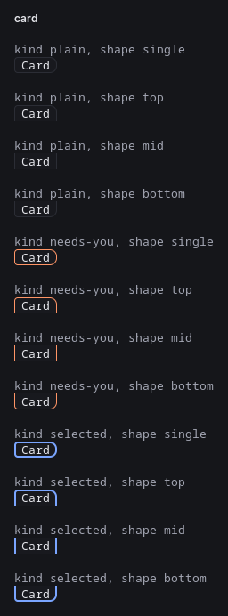
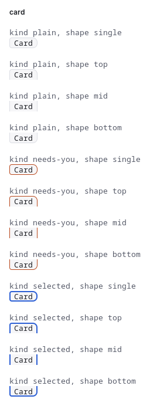
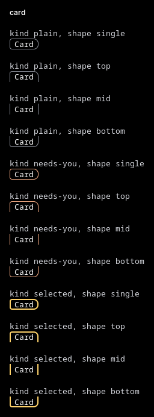

# Card (kit)

<!-- Generated by `bin/drgnx design` from etc/ui/components.eld. Do not edit; change the source and regenerate. -->

The kit's `card` component: one definition in `etc/ui/components.eld`, expanded the same way by the hub (`drgnx_rows::kit`) and by the Lisp chrome (`drgnx-ui-kit-expand`). Sizes are logical pixels; every colour is a [token](../tokens.md). Open it live with **Design: Component Catalogue**.

## Variants

- `kind`: `plain`, `needs-you`, `selected` (default `plain`)
- `shape`: `single`, `top`, `mid`, `bottom` (default `single`)

## Geometry

| Variant | Density | Height | Pad (start / end) | Gap | Box | Radius | Hit | Indent |
|---|---|---|---|---|---|---|---|---|
| plain single | compact | 0 | 8 / 8 | 0 | yes | 8 | 0 | - |
| plain single | comfortable | 0 | 8 / 8 | 0 | yes | 8 | 0 | - |
| plain single | roomy | 0 | 8 / 8 | 0 | yes | 8 | 0 | - |
| plain top | compact | 0 | 8 / 8 | 0 | yes | 8 | 0 | - |
| plain top | comfortable | 0 | 8 / 8 | 0 | yes | 8 | 0 | - |
| plain top | roomy | 0 | 8 / 8 | 0 | yes | 8 | 0 | - |
| plain mid | compact | 0 | 8 / 8 | 0 | yes | 8 | 0 | - |
| plain mid | comfortable | 0 | 8 / 8 | 0 | yes | 8 | 0 | - |
| plain mid | roomy | 0 | 8 / 8 | 0 | yes | 8 | 0 | - |
| plain bottom | compact | 0 | 8 / 8 | 0 | yes | 8 | 0 | - |
| plain bottom | comfortable | 0 | 8 / 8 | 0 | yes | 8 | 0 | - |
| plain bottom | roomy | 0 | 8 / 8 | 0 | yes | 8 | 0 | - |
| needs-you single | compact | 0 | 8 / 8 | 0 | yes | 8 | 0 | - |
| needs-you single | comfortable | 0 | 8 / 8 | 0 | yes | 8 | 0 | - |
| needs-you single | roomy | 0 | 8 / 8 | 0 | yes | 8 | 0 | - |
| needs-you top | compact | 0 | 8 / 8 | 0 | yes | 8 | 0 | - |
| needs-you top | comfortable | 0 | 8 / 8 | 0 | yes | 8 | 0 | - |
| needs-you top | roomy | 0 | 8 / 8 | 0 | yes | 8 | 0 | - |
| needs-you mid | compact | 0 | 8 / 8 | 0 | yes | 8 | 0 | - |
| needs-you mid | comfortable | 0 | 8 / 8 | 0 | yes | 8 | 0 | - |
| needs-you mid | roomy | 0 | 8 / 8 | 0 | yes | 8 | 0 | - |
| needs-you bottom | compact | 0 | 8 / 8 | 0 | yes | 8 | 0 | - |
| needs-you bottom | comfortable | 0 | 8 / 8 | 0 | yes | 8 | 0 | - |
| needs-you bottom | roomy | 0 | 8 / 8 | 0 | yes | 8 | 0 | - |
| selected single | compact | 0 | 8 / 8 | 0 | yes | 8 | 0 | - |
| selected single | comfortable | 0 | 8 / 8 | 0 | yes | 8 | 0 | - |
| selected single | roomy | 0 | 8 / 8 | 0 | yes | 8 | 0 | - |
| selected top | compact | 0 | 8 / 8 | 0 | yes | 8 | 0 | - |
| selected top | comfortable | 0 | 8 / 8 | 0 | yes | 8 | 0 | - |
| selected top | roomy | 0 | 8 / 8 | 0 | yes | 8 | 0 | - |
| selected mid | compact | 0 | 8 / 8 | 0 | yes | 8 | 0 | - |
| selected mid | comfortable | 0 | 8 / 8 | 0 | yes | 8 | 0 | - |
| selected mid | roomy | 0 | 8 / 8 | 0 | yes | 8 | 0 | - |
| selected bottom | compact | 0 | 8 / 8 | 0 | yes | 8 | 0 | - |
| selected bottom | comfortable | 0 | 8 / 8 | 0 | yes | 8 | 0 | - |
| selected bottom | roomy | 0 | 8 / 8 | 0 | yes | 8 | 0 | - |

## On a terminal

- padding: 1 character(s) each side

## Spoken label

None: the row's own text is what a screen reader speaks.

## Colours

| Binding | Face | Fill | Text | Edge |
|---|---|---|---|---|
| plain single | `drgnx-kit-card-plain-single` | panel | - | border-strong |
| plain top | `drgnx-kit-card-plain-top` | panel | - | border-strong |
| plain mid | `drgnx-kit-card-plain-mid` | panel | - | border-strong |
| plain bottom | `drgnx-kit-card-plain-bottom` | panel | - | border-strong |
| needs-you single | `drgnx-kit-card-needs-you-single` | panel | - | card-needs-you-edge |
| needs-you top | `drgnx-kit-card-needs-you-top` | panel | - | card-needs-you-edge |
| needs-you mid | `drgnx-kit-card-needs-you-mid` | panel | - | card-needs-you-edge |
| needs-you bottom | `drgnx-kit-card-needs-you-bottom` | panel | - | card-needs-you-edge |
| selected single | `drgnx-kit-card-selected-single` | panel | - | focus |
| selected top | `drgnx-kit-card-selected-top` | panel | - | focus |
| selected mid | `drgnx-kit-card-selected-mid` | panel | - | focus |
| selected bottom | `drgnx-kit-card-selected-bottom` | panel | - | focus |

## States

| State | Fill | Ring | Text | Face | Terminal |
|---|---|---|---|---|---|
| rest | the surface | - | unchanged | - | - |
| hover | `hover` | - | unchanged | `drgnx-hover` | none |
| pressed | `sel-quiet` | - | unchanged | `drgnx-selected-quiet` | - |
| selected | `sel`, radius 6 | - | unchanged | `drgnx-selected` | inverse |
| selected-inactive | `sel-inactive`, radius 6 | - | unchanged | `drgnx-selected-inactive` | underline |
| focus-visible | the surface | `focus`, 2 px inset | unchanged | `drgnx-focus` | inverse |
| disabled | the surface | - | `disabled` | `drgnx-text-disabled` | dim |
