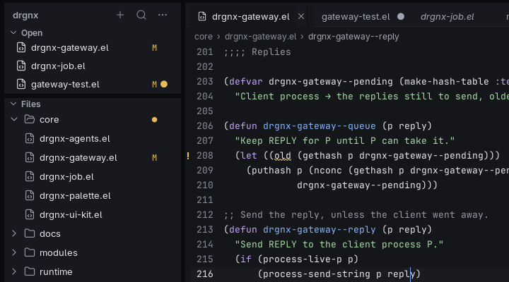
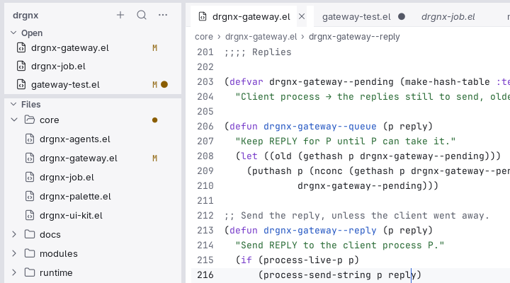

# Cards

The window is **islands on a gap**: the Explorer, each editor group, the agent panel, the terminal and the Work space's
views are cards, set on a slightly darker surface. This is the look's first impression, and the first thing that goes
wrong when a new view draws its own background.

## Anatomy

- The **gap** is the surface behind and between cards (`drgnx-surface-gap`). In dark it is darker than the editor; in
  light it is darker than the white editor, so the cards still read as raised.
- A **card** has radius 10, a 1 px edge just outside it in the gap (the `border` colour at 0.6 opacity in dark, 0.8 in
  light, 1.0 in high contrast) and a barely-there shadow (0 1 3, 45 % dark, 8 % light).
- The gap between cards is 4, 6 or 8 px by density; the same width is the outer margin.
- A card holds one view, or a **card group** (one card for windows that tile a rectangle).
- Inside a view, a **card of rows** (an agent's step, a board card) is a run of rows on the quiet selection with a 1 px ring; the selected one has a 2 px ring in the accent.

## Faces and tokens

| Part | Face | Token |
|---|---|---|
| Gap | `drgnx-surface-gap` | `gap` |
| Side panel | `drgnx-surface-panel` | `panel` |
| Editor | `default` | `editor` |
| Card of rows inside a view (the agent panel's cards, Board cards): a first, middle, last or only row | `drgnx-card-top`, `-mid`, `-bottom`, `-single` | `sel-quiet` fill, `border-strong` ring |
| The selected card of those | `drgnx-card-sel-top`, `-mid`, `-bottom`, `-single` | the same fill, a 2 px ring in the `accent` |

## Rules

- A card's surface is a semantic face (`drgnx-surface-*`), never a colour of the view's own.
- A thing inside a card that is itself rounded takes the card's radius minus the gap to the edge (never the card's 10).
- Selected rows and tints inside a card sit inset from its edge by at least 4 px; they never run edge to edge.
- Per-corner radii, two boxes on one face and a different divider colour per window are not available in the
  compositor: do not design for them.
- High contrast has no shadow: the edge is a 1 or 2 px ring.
