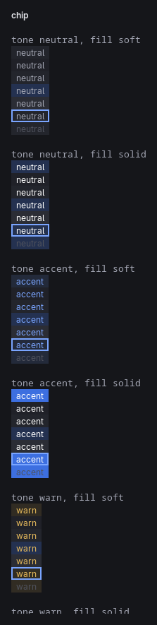
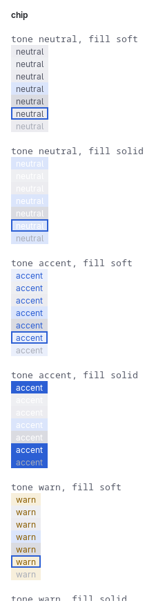
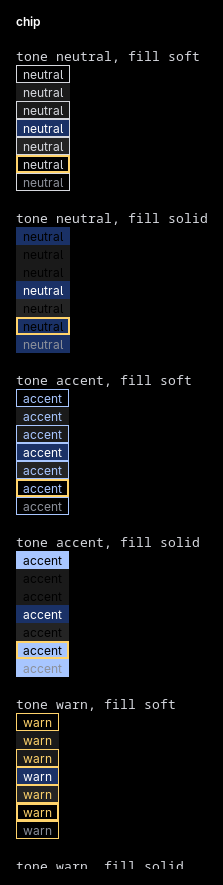

# Chip (kit)

<!-- Generated by `bin/drgnx design` from etc/ui/components.eld. Do not edit; change the source and regenerate. -->

The kit's `chip` component: one definition in `etc/ui/components.eld`, expanded the same way by the hub (`drgnx_rows::kit`) and by the Lisp chrome (`drgnx-ui-kit-expand`). Sizes are logical pixels; every colour is a [token](../tokens.md). Open it live with **Design: Component Catalogue**.

## Variants

- `tone`: `neutral`, `accent`, `warn`, `ok`, `error`, `agent` (default `neutral`)
- `fill`: `soft`, `solid` (default `soft`)

## Geometry

| Variant | Density | Height | Pad (start / end) | Gap | Box | Radius | Hit | Indent |
|---|---|---|---|---|---|---|---|---|
| neutral soft | compact | 20 | 7 / 7 | 5 | yes | 4 | - | - |
| neutral soft | comfortable | 20 | 7 / 7 | 5 | yes | 4 | - | - |
| neutral soft | roomy | 20 | 7 / 7 | 5 | yes | 4 | - | - |
| neutral solid | compact | 20 | 7 / 7 | 5 | yes | 4 | - | - |
| neutral solid | comfortable | 20 | 7 / 7 | 5 | yes | 4 | - | - |
| neutral solid | roomy | 20 | 7 / 7 | 5 | yes | 4 | - | - |
| accent soft | compact | 20 | 7 / 7 | 5 | yes | 4 | - | - |
| accent soft | comfortable | 20 | 7 / 7 | 5 | yes | 4 | - | - |
| accent soft | roomy | 20 | 7 / 7 | 5 | yes | 4 | - | - |
| accent solid | compact | 20 | 7 / 7 | 5 | yes | 4 | - | - |
| accent solid | comfortable | 20 | 7 / 7 | 5 | yes | 4 | - | - |
| accent solid | roomy | 20 | 7 / 7 | 5 | yes | 4 | - | - |
| warn soft | compact | 20 | 7 / 7 | 5 | yes | 4 | - | - |
| warn soft | comfortable | 20 | 7 / 7 | 5 | yes | 4 | - | - |
| warn soft | roomy | 20 | 7 / 7 | 5 | yes | 4 | - | - |
| warn solid | compact | 20 | 7 / 7 | 5 | yes | 4 | - | - |
| warn solid | comfortable | 20 | 7 / 7 | 5 | yes | 4 | - | - |
| warn solid | roomy | 20 | 7 / 7 | 5 | yes | 4 | - | - |
| ok soft | compact | 20 | 7 / 7 | 5 | yes | 4 | - | - |
| ok soft | comfortable | 20 | 7 / 7 | 5 | yes | 4 | - | - |
| ok soft | roomy | 20 | 7 / 7 | 5 | yes | 4 | - | - |
| ok solid | compact | 20 | 7 / 7 | 5 | yes | 4 | - | - |
| ok solid | comfortable | 20 | 7 / 7 | 5 | yes | 4 | - | - |
| ok solid | roomy | 20 | 7 / 7 | 5 | yes | 4 | - | - |
| error soft | compact | 20 | 7 / 7 | 5 | yes | 4 | - | - |
| error soft | comfortable | 20 | 7 / 7 | 5 | yes | 4 | - | - |
| error soft | roomy | 20 | 7 / 7 | 5 | yes | 4 | - | - |
| error solid | compact | 20 | 7 / 7 | 5 | yes | 4 | - | - |
| error solid | comfortable | 20 | 7 / 7 | 5 | yes | 4 | - | - |
| error solid | roomy | 20 | 7 / 7 | 5 | yes | 4 | - | - |
| agent soft | compact | 20 | 7 / 7 | 5 | yes | 4 | - | - |
| agent soft | comfortable | 20 | 7 / 7 | 5 | yes | 4 | - | - |
| agent soft | roomy | 20 | 7 / 7 | 5 | yes | 4 | - | - |
| agent solid | compact | 20 | 7 / 7 | 5 | yes | 4 | - | - |
| agent solid | comfortable | 20 | 7 / 7 | 5 | yes | 4 | - | - |
| agent solid | roomy | 20 | 7 / 7 | 5 | yes | 4 | - | - |

## On a terminal

- padding: 1 character(s) each side

## Spoken label

None: the row's own text is what a screen reader speaks.

## Colours

| Binding | Face | Fill | Text | Edge |
|---|---|---|---|---|
| neutral soft | `drgnx-kit-chip-neutral-soft` | sel-quiet | muted | - |
| accent soft | `drgnx-kit-chip-accent-soft` | accent-tint | accent | - |
| warn soft | `drgnx-kit-chip-warn-soft` | warn-tint | warn | - |
| ok soft | `drgnx-kit-chip-ok-soft` | ok-tint | ok | - |
| error soft | `drgnx-kit-chip-error-soft` | error-tint | error | - |
| neutral solid | `drgnx-kit-chip-neutral-solid` | sel | on-accent | - |
| accent solid | `drgnx-kit-chip-accent-solid` | accent-fill | on-accent | - |
| warn solid | `drgnx-kit-chip-warn-solid` | warn | on-accent | - |
| ok solid | `drgnx-kit-chip-ok-solid` | ok | on-accent | - |
| error solid | `drgnx-kit-chip-error-solid` | error | on-accent | - |

## States

| State | Fill | Ring | Text | Face | Terminal |
|---|---|---|---|---|---|
| rest | the surface | - | unchanged | - | - |
| hover | `hover` | - | unchanged | `drgnx-hover` | none |
| pressed | `sel-quiet` | - | unchanged | `drgnx-selected-quiet` | - |
| selected | `sel`, radius 6 | - | unchanged | `drgnx-selected` | inverse |
| selected-inactive | `sel-inactive`, radius 6 | - | unchanged | `drgnx-selected-inactive` | underline |
| focus-visible | the surface | `focus`, 2 px inset | unchanged | `drgnx-focus` | inverse |
| disabled | the surface | - | `disabled` | `drgnx-text-disabled` | dim |
