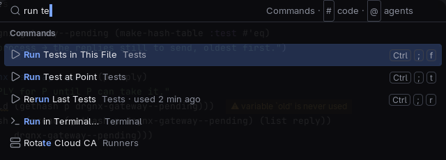

# Chips, keycaps and buttons

The small things inside rows, bars and cards: a **chip** says a status or a name, a **keycap** shows a key, a
**button** runs something, a **pill** is a choice.

## Anatomy

| Piece | Look | Radius | Face |
|---|---|---|---|
| Chip | caption text on a tint, 7 px of room either side, no ring | 4 | `drgnx-chip-quiet`, `-accent`, `-attention`, `-ok`, `-warn`, `-error`; `drgnx-chip-solid` for a filled one |
| Key hint | the keys in the code font in a 1 px ring (`key-hint-edge`), 5 px of room either side | 4 | `drgnx-kit-key-hint-cap`; `-menu` is the text alone (`drgnx-keycap` is its alias) |
| Button | the quiet selection's fill in a 1 px ring (`button-edge`), 12 px of room either side, 26 px tall (22 small), its key hint after the label | 6 | `drgnx-kit-button-secondary`, `-primary` for the main action, `-quiet`, `-danger` (see [button](button.md), [key hint](key-hint.md)) |
| Choice pill | caption text in a 1 px ring; the chosen one is the accent on its tint | 6 | `drgnx-pill`, `drgnx-pill-on`, `drgnx-pill-accent`, `drgnx-pill-agent` |

## Rules

- A chip is a tint with room inside it. The colour says the kind, and the words say it again: never colour alone.
- High contrast has no tints: a chip is ringed in its own text colour, with the same room.
- A key alone reads as typed (`a`, `D`: Shift with a letter is its capital); with another modifier a letter is a
  capital (`Ctrl Shift P`, `Alt X`); Enter is `↵`.
- The main action of a group is the one `drgnx-kit-button-primary`; a group has at most one.
- A ring's colour cannot be inherited, so the theme gives it. Do not write a colour on a face to get a ring.
- Chips are as tall as their text, never taller than the row they sit in.

## Agent marks and progress

Two kit components that sit inside rows, cards and bars, each defined once in `etc/ui/components.eld` and expanded
the same way by the hub (`Comp::AgentMark`, `Comp::Progress`) and by Lisp chrome (`drgnx-ui-kit-agent-mark`,
`drgnx-ui-kit-progress`). Their generated pages hold the numbers and the sheets: [agent mark](agent-mark.md) and
[progress](progress.md).

### Agent marks

An agent's handle (one or two letters) on its colour, the way an avatar marks a person.

- **Anatomy:** a 5 px pad, the handle in the caption size, a 5 px pad, about 18 px square. Radius 4 where Glitnir
  rounds.
- **Colour:** the agent's slot (1–12, from `drgnx-agent-identity`) picks its face `drgnx-agent-N`. The kit face
  `drgnx-kit-agent-mark` draws it in inverse video, so the agent's colour is the fill and the surface's colour is the
  letter. A theme that colours `drgnx-agent-N` colours the marks too.
- **Terminal:** `[H]` in the agent's colour.
- **Spoken label:** "agent H" (its `help-echo`).

### Progress

How far something has got, as a bar or a ring.

- **Bar:** the fill (`progress-fill`, the accent) then the track (`progress-track`), each 4 px high. The fill is the
  value times the bar's width in device pixels, rounded half up. On a terminal it is one cell per 8 px of the width
  between `▕` and `▏` (ASCII `[` and `]`), the filled cells `█` (ASCII `#`).
- **Ring:** one of `○ ◔ ◑ ◕ ●` (ASCII `0`–`4`), the value rounded to the nearest quarter, in the fill colour.
- **Spoken label:** "N percent" (its `help-echo`).

### Rules for marks and progress

- Do give a mark its slot, never a colour: the slot's face follows the theme, high contrast included.
- Don't draw a bar as text (`▰▱`) on a graphical frame: use the kit, so the fill's width is exact at every scale.
- Don't pulse or animate progress when the user has asked for reduced motion; the kit draws none.
