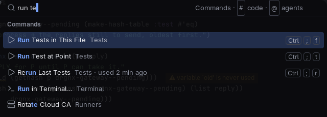
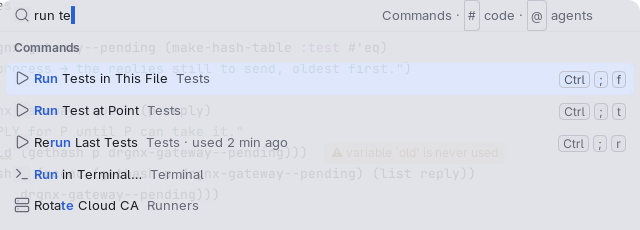

# Chips, keycaps and buttons

The small things inside rows, bars and cards: a **chip** says a status or a name, a **keycap** shows a key, a
**button** runs something, a **pill** is a choice.

## Anatomy

| Piece | Look | Radius | Face |
|---|---|---|---|
| Chip | caption text on a tint, 7 px of room either side, no ring | 4 | `drgnx-chip-quiet`, `-accent`, `-attention`, `-ok`, `-warn`, `-error`; `drgnx-chip-solid` for a filled one |
| Keycap | subtle caption text in a 1 px ring of the strong border | 4 | `drgnx-keycap` |
| Button | the quiet selection's fill in a 1 px border ring, 12 px of room either side, 26 px tall | 6 | `drgnx-control`; `drgnx-control-primary` for the main action |
| Choice pill | caption text in a 1 px ring; the chosen one is the accent on its tint | 6 | `drgnx-pill`, `drgnx-pill-on`, `drgnx-pill-accent`, `drgnx-pill-agent` |

## Rules

- A chip is a tint with room inside it. The colour says the kind, and the words say it again: never colour alone.
- High contrast has no tints: a chip is ringed in its own text colour, with the same room.
- A key alone reads as typed (`a`, `D`: Shift with a letter is its capital); with another modifier a letter is a
  capital (`Ctrl Shift P`, `Alt X`); Enter is `↵`.
- The main action of a group is the one `drgnx-control-primary`; a group has at most one.
- A ring's colour cannot be inherited, so the theme gives it. Do not write a colour on a face to get a ring.
- Chips are as tall as their text, never taller than the row they sit in.
