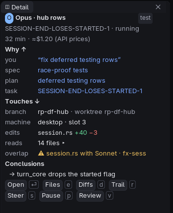
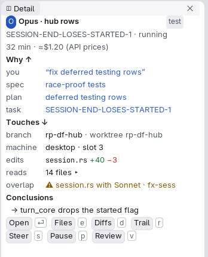

# Detail island

The card at the right of a Work space view that shows the selected thing in full: a task, an agent, a file, a gate.

## Anatomy

- A [card](cards.md) on the gap, to the right of the lens and above its rules tile.
- A header with the thing's name and kind as a chip; under it, sections in the caption role: why it is where it is, what
  clears it, evidence so far, and its actions as buttons (the main one `drgnx-control-primary`).
- An agent is shown by its colour, its mark and its name together, never by colour alone.
- The maximise button on the [lens bar](lens-bar.md) hides it, so the lens fills the window.

## Faces and tokens

`drgnx-surface-panel` for the card, `drgnx-ui-heading` for section heads, `drgnx-text-muted` for the explanations,
`drgnx-chip-*` for kinds and states, the agent faces `drgnx-agent-1` to `-6` (and the `drgnx-work-who-N` badges that fill
an agent's colour with the editor's colour for its initial).

## Rules

- What the island shows follows the selection at once; it never keeps showing a thing that went.
- `attention` appears once, on the one thing that waits for you.
- Actions are buttons with a key shown as a keycap; a disabled action is `drgnx-text-disabled`, not hidden.
