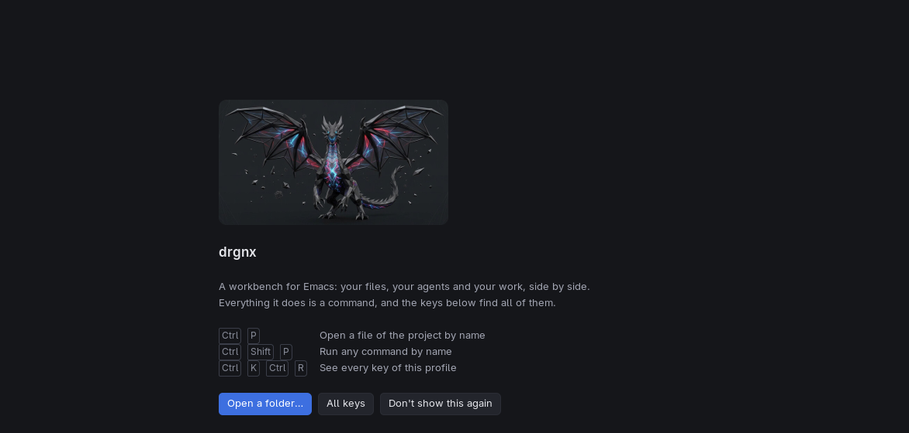
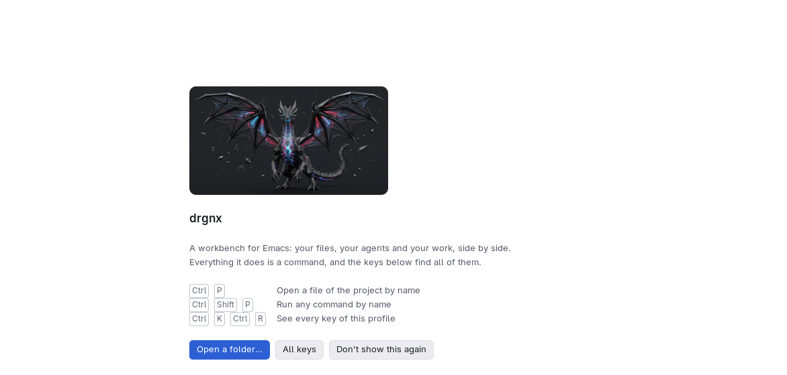

# Empty states

What a list or view says when there is nothing in it. An empty card is never left blank.

## Anatomy

- A short line that says what is missing and why (`No problems`, `Nothing waits for you`), in muted text.
- When there is something to do, one action: a [button](chips-and-keys.md), with its key as a keycap.
- The start page is the model: the project's mark, a title, a table of keys (keycaps, then what they do, the
  descriptions starting 16 px after the widest key), and a row of buttons.

## Faces and tokens

`drgnx-start-title`, `drgnx-start-quiet` (shadow), the button and keycap faces ([chips](chips-and-keys.md)),
`drgnx-text-muted` for the line.

## Rules

- Say what to do, not only what is missing.
- Keep the card's size and header: an empty state replaces the rows, not the view.
- No illustration is required; if one is used it takes its colours from the tokens like everything else.
- The empty state is part of every scene a list is judged by: show the list empty, with a long name, and with a
  thousand items.
