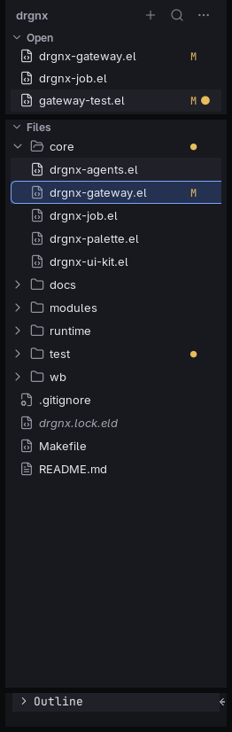
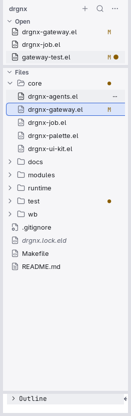

# Explorer

The file tree, and the pattern every list in drgnx follows: sections, rows, a state ladder, an end column.

## Anatomy

- A **card** on the gap ([cards](cards.md)) with a header: the project's name, then new, search and more buttons.
- **Sections** (`Open`, `Files`): a chevron and a label in the caption role; each folds.
- **Rows** are 26 px (22 compact, 30 roomy): a chevron for a folder, a 16 px [icon](../icons.md) chosen by the file's
  kind, the name, and an end column of caption text: the git state (`M`) and a dot for something modified inside.
- The indent is 12 px a level (14 roomy); guides and chevrons are quiet.
- A section can be a bar at the bottom (`Outline`) that opens upward.

## State ladder

| State | Look |
|---|---|
| Rest | no fill |
| Hover | the `hover` tint, inset from the card's edge and rounded |
| Selected, list without the focus | `sel-inactive`: at least 1.25:1 against the panel |
| Selected, list focused | `sel` plus a 1 px inset ring in `focus` |

Each step is visibly different; hover never equals or outranks selected. Text on the selection uses muted or a raised
subtle, never subtle: it must hold 4.5:1 on the tint.

## Faces and tokens

`drgnx-explorer-root` (bold), `-directory`, `-file`, `-guide` (the chevrons and guides, shadow), `-selected` (rows chosen
together); the ladder is `drgnx-hover`, `drgnx-selected-inactive`, `drgnx-selected` and `drgnx-focus`; the end column is
`drgnx-ui-caption`; git states take the `drgnx-status-*` faces.

## Rules

- A selected row is a soft tint, inset at least 4 px from the card edge: never an edge-to-edge block.
- An icon takes the colour of its text; never give an icon a colour of its own.
- Long names end in an ellipsis and never push the end column; a thousand rows scroll without a layout shift.
- The Explorer is beaten by nothing: any new list uses these rows, this ladder and these sizes.
