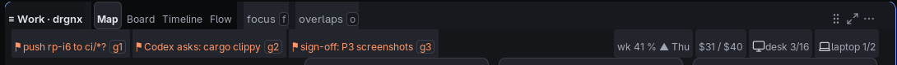
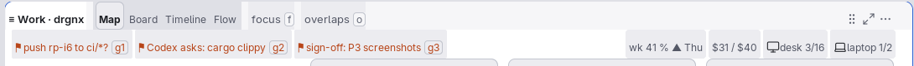

# Lens bar

The Work space's tab line: it names the views (Map, Board, Timeline, Flow) of one set of work and switches between them.

## Anatomy

- A **rail** along the top of the lens's card, on the gap's colour, with a label per view; the one shown is a raised
  **pill**, the others are quiet text. Each label can show its key as a small keycap (`m`, `b`, `t`, `F`).
- At the right end: a grip (the tile layout's drag handle), a maximise button (hides the Detail island and the trail;
  again shows them) and a `⋯` that appears while the bar is hovered and opens the list of views and a keys sheet.
- A filter strip sits under the bar and above the content.

## Faces and tokens

`drgnx-work-lens-rail` (the rail, in the label face), `drgnx-work-lens-seg` (a view that is not shown),
`drgnx-work-lens-current` (the view shown: bold on the quiet selection, like an active pill), `drgnx-work-lens-key` (a
keycap), `drgnx-work-lens-title` (the heading of the view).

## Rules

- The shown view is told apart by fill and weight, not colour alone.
- The `⋯` shows on hover only because the bar's size must not change when it does.
- Keys on the bar are the same keys the view answers to, written as typed.
