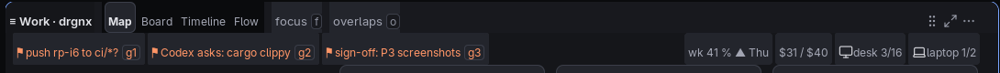
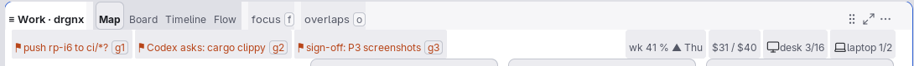

# Lens bar

The Work space's tab line: it names the views (Map, Board, Timeline, Flow) of one set of work and switches between them.

## Anatomy

- The Work space's **tab** (the kit's [shown editor tab](tab.md), "Work · NAME"), then the views as the kit's
  [segmented switch](segmented.md): one ringed track, the view shown on the quiet selection, the others muted text;
  a click on one switches the lens of the window it is in. The lens's own keys follow as chips with a keycap each.
- At the right end: a grip (the tile layout's drag handle), a maximise button (hides the Detail island and the trail;
  again shows them) and a `⋯` that appears while the bar is hovered and opens the list of views and a keys sheet.
- A filter strip sits under the bar and above the content.

## Faces and tokens

`drgnx-kit-tab-current` (the tab), `drgnx-kit-segmented` (the track and a view that is not shown),
`drgnx-kit-segmented-current` (the view shown), `drgnx-work-chip` and `drgnx-work-lens-key` (a lens key and its keycap).
`drgnx-work-lens-title`, `-rail`, `-seg` and `-current` are aliases of the kit faces.

## Rules

- The shown view is told apart by its fill (inverse video on a terminal), never by weight: no bold in the bar.
- The `⋯` shows on hover only because the bar's size must not change when it does.
- Keys on the bar are the same keys the view answers to, written as typed.
