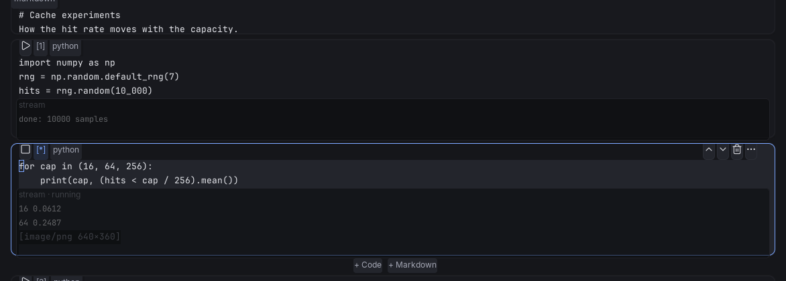
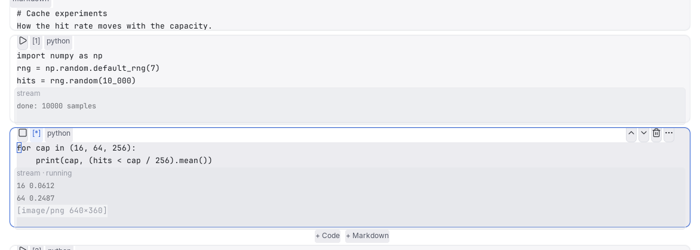

# Notebook cell

A cell of a Jupyter notebook buffer: a header strip, the source, the output. Where Glitnir draws blocks (a graphical
Nidhogg) the cell is a card; everywhere else (a terminal) it is a tinted band. The mockup is `the-look/notebook.html`.

## Anatomy

| Piece | Look | Face |
|---|---|---|
| Card | a 1 px ring, radius 10, around the cell's rows; the corners outside it show the editor's background | a Glitnir `ring` block, `:ring` the faces below, `:beneath` `default` |
| Fill | the cell's rows' tint, to the text area's edges (the fringes, 16 px each side, are the card's inset from the window) | `drgnx-notebook-cell`; `drgnx-notebook-cell-selected` for the selected cell |
| Ring colour | rest: the subtle border; selected, window not focused: the strong border; selected, window focused: the focus colour | `drgnx-border-subtle`, `drgnx-border-strong`, `drgnx-focus-line` |
| Header strip | run button, then the hub's head (`[3]  python`); no hairline over it on a card, the ring is the edge | `drgnx-notebook-head`, `drgnx-notebook-run-button` |
| Output | under the source, in the card, in an inner panel (darker fill, 1 px border, radius 6) under a label row (`stream`, `stream · running`, `error`); errors on the error tint | `drgnx-notebook-output`, `-stale`, `-error`, `drgnx-notebook-panel` |
| Add row | `+ Code` and `+ Markdown` chips, centred between the selected cell and the next | `drgnx-notebook-chip`, `drgnx-chip` |

## Rules

- The focus ring is on the selected cell of the selected window only; no ring is a quieter tint plus a stronger border.
- The band look is not a degraded card: a terminal, and a graphical frame without blocks, keep it, with the hairline over each
  header.
- The blocks are set on the window only when they change (a rescan, the selection, the focus), never per redisplay.

## What the mockup has and the block cannot yet draw

The card is drawn: 8 px apart (a 4 px gap each side), the look's card shadow, the focused card's inner focus ring and
outer border step, the output inside the ring, an output panel (a darker fill from `drgnx-notebook-panel`, a 1 px
border, radius 6, a stream label row) and the add row between cards. What still differs from the mockup is in the plan's
ledger (T11c): the 8 px margin between the panel and the card's bottom edge, the add row's hover, rendered markdown
cells.
