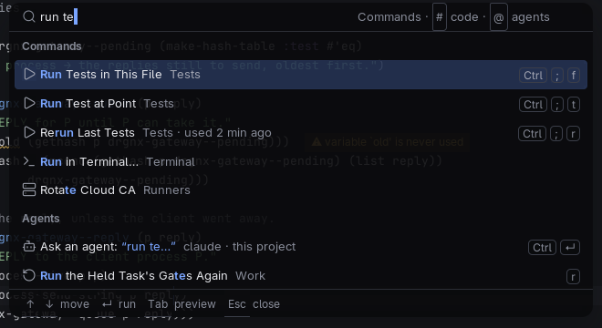
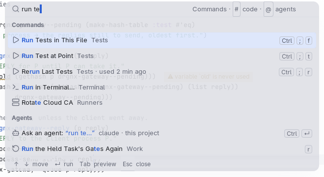

# Palette

The floating command palette, which is also Quick Open and the search for everything: type, see candidates, press Return.

## Anatomy

- A **modal** (radius 12) at the top centre of the editor frame, 640 px wide (less in a narrow frame): prompt and typed
  text on top, the candidates under it, a footer of keys at the bottom.
- Candidates come in groups (`Commands`, `Files`, `Agents`) with a quiet group label; each row is an icon, the label, its
  category, when you last ran it, and its keys as keycaps.
- The footer says what the keys do: move, run, preview, close.
- 90 % opaque over a 16 px blur of what lies behind; shadow 0 16 48 at 50 % dark and 22 % light, with a 1 px edge.
  High contrast: opaque, no shadow, no blur, a 2 px ring.

## Faces and tokens

`drgnx-surface-overlay` for the box; `drgnx-palette-group` for group labels; `drgnx-palette-footer` (caption text under a
hairline of `border`); `drgnx-keycap` for keys; the selected row `drgnx-selected` with `drgnx-selected-secondary` for its
secondary text (muted, which holds 4.5:1 on the selection where subtle does not); `drgnx-palette-asked` marks what you
typed that an agent was asked.

## Rules

- Keyboard focus never moves: the palette is a child frame that cannot take focus.
- Motion is a pop in over about 120 ms and a fade out over 80 ms; reduced motion removes both and keeps the blur.
- Text on the selected row stays at 4.5:1; the footer is never the only place a key is shown.
- In a terminal, or without the compositor, the palette is the minibuffer: do not rely on rounding or blur for meaning.
