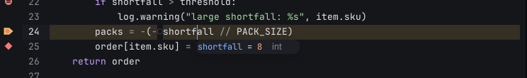
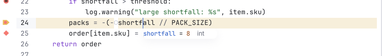

# Popups

Things that float over the code for a moment: completion, documentation, which-key, transient menus, the quick help card
and notices. The second of the [three elevations](../index.md#rules-that-hold-everywhere).

## Anatomy

- Radius 8, a soft shadow (0 6 16 at 35 % dark, 14 % light), a 1 px ring.
- In high contrast there is no shadow: a 1 px `border-strong` ring.
- Descriptions use the UI font; keys use the code font.
- Notices (toasts) stack at most three at a time; the rest count as `+2` in the status bar.

## Faces and tokens

`drgnx-surface-overlay` for the fill, `drgnx-border-strong` for the ring, `tooltip` for the quick help card
(`drgnx-quickhelp`, its title `drgnx-quickhelp-title`, a data tip `drgnx-quickhelp-data-tip` in the small code role),
`completions-highlight` for the current candidate.

## Rules

- A popup never hides the thing it is about: it opens beside or under it.
- Popups appear and leave quickly and can be dismissed with `C-g`; none takes keyboard focus from the editor unless it is
  a menu you opened.
- A popup nested in a popup uses the outer radius minus the gap, never 8 again.
- No new ad-hoc shadows: popups use the popup elevation, overlays the modal one.
