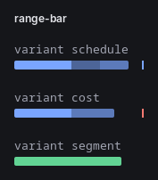
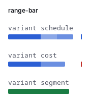
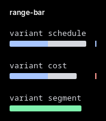

# Range Bar (kit)

<!-- Generated by `bin/drgnx design` from etc/ui/components.eld. Do not edit; change the source and regenerate. -->

The kit's `range-bar` component: one definition in `etc/ui/components.eld`, expanded the same way by the hub (`drgnx_rows::kit`) and by the Lisp chrome (`drgnx-ui-kit-expand`). Sizes are logical pixels; every colour is a [token](../tokens.md). Open it live with **Design: Component Catalogue**.

## Variants

- `variant`: `schedule`, `cost`, `segment` (default `schedule`)

## Geometry

| Variant | Density | Height | Pad (start / end) | Gap | Box | Radius | Hit | Indent |
|---|---|---|---|---|---|---|---|---|
| schedule | compact | 0 | 0 / 0 | 0 | no | 2 | 0 | - |
| schedule | comfortable | 0 | 0 / 0 | 0 | no | 2 | 0 | - |
| schedule | roomy | 0 | 0 / 0 | 0 | no | 2 | 0 | - |
| cost | compact | 0 | 0 / 0 | 0 | no | 2 | 0 | - |
| cost | comfortable | 0 | 0 / 0 | 0 | no | 2 | 0 | - |
| cost | roomy | 0 | 0 / 0 | 0 | no | 2 | 0 | - |
| segment | compact | 0 | 0 / 0 | 0 | no | 2 | 0 | - |
| segment | comfortable | 0 | 0 / 0 | 0 | no | 2 | 0 | - |
| segment | roomy | 0 | 0 / 0 | 0 | no | 2 | 0 | - |

## On a terminal

- padding: 0 character(s) each side

## Spoken label

"range"

## Colours

| Binding | Face | Fill | Text | Edge |
|---|---|---|---|---|
| own | `drgnx-kit-range-bar` | - | range-done | - |
| forecast | `drgnx-kit-range-bar-forecast` | - | range-forecast | - |
| tail | `drgnx-kit-range-bar-tail` | - | range-tail | - |
| late | `drgnx-kit-range-bar-late` | - | range-late | - |
| wait | `drgnx-kit-range-bar-wait` | - | range-wait | - |
| seg-read | `drgnx-kit-range-bar-seg-read` | - | seg-read | - |
| seg-search | `drgnx-kit-range-bar-seg-search` | - | seg-search | - |
| seg-web | `drgnx-kit-range-bar-seg-web` | - | seg-web | - |
| seg-think | `drgnx-kit-range-bar-seg-think` | - | seg-think | - |
| seg-edit | `drgnx-kit-range-bar-seg-edit` | - | seg-edit | - |
| seg-test | `drgnx-kit-range-bar-seg-test` | - | seg-test | - |
| seg-job | `drgnx-kit-range-bar-seg-job` | - | seg-job | - |
| seg-wait | `drgnx-kit-range-bar-seg-wait` | - | seg-wait | - |

## States

| State | Fill | Ring | Text | Face | Terminal |
|---|---|---|---|---|---|
| rest | the surface | - | unchanged | - | - |
| hover | `hover` | - | unchanged | `drgnx-hover` | none |
| pressed | `sel-quiet` | - | unchanged | `drgnx-selected-quiet` | - |
| selected | `sel`, radius 6 | - | unchanged | `drgnx-selected` | inverse |
| selected-inactive | `sel-inactive`, radius 6 | - | unchanged | `drgnx-selected-inactive` | underline |
| focus-visible | the surface | `focus`, 2 px inset | unchanged | `drgnx-focus` | inverse |
| disabled | the surface | - | `disabled` | `drgnx-text-disabled` | dim |
