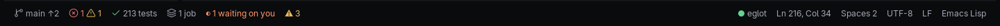
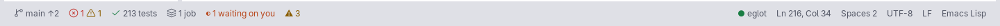

# Status bar

One quiet bar across the bottom of the window, under every pane. It is a window of its own that drgnx keeps at the
frame's bottom; the editors have no mode line. What you need at a glance, nothing that shouts.

## Anatomy

24 px tall (22 compact, 28 roomy), set in the caption role, laid out in pixels.

- **Left:** the branch (`main ↑2`), a shield while the folder is untrusted, the problems (`✕ 1 ⚠ 1`, or a check when
  there are none), the last test run (`✓ 213 tests`), running jobs, and what needs you (`5` in the attention colour).
- **Right:** the language server (a dot and its name), the position (`Ln 216, Col 34`), the indent (`Spaces 2`), the
  encoding, the line ending and the language.
- Each segment is clickable and acts in the editor you used last.

The full list of segments and what each click does is in [the face reference](../../guide/face.md#the-status-bar).

## Faces and tokens

The bar is `mode-line` on the gap (`drgnx-surface-gap` colours), in `drgnx-ui-caption`. Status uses `drgnx-status-ok`,
`-warn`, `-fail`, `-info` and `-attention`; quiet text is `drgnx-text-muted` or `-subtle`.

## Rules

- Status is an icon and a number together: never a colour alone.
- Only one thing in the bar is `attention`, and only while something waits for you.
- Everything is the UI role in caption size; the code font never appears here.
- A segment that has nothing to say is absent, not greyed: the bar does not reflow when a test run starts.
