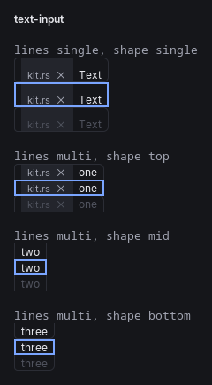
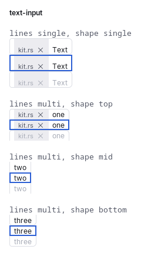
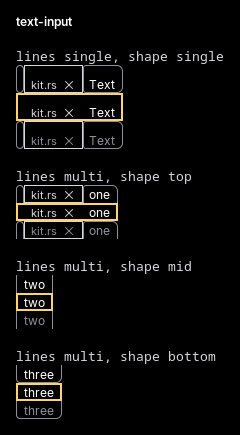

# Text Input (kit)

<!-- Generated by `bin/drgnx design` from etc/ui/components.eld. Do not edit; change the source and regenerate. -->

The kit's `text-input` component: one definition in `etc/ui/components.eld`, expanded the same way by the hub (`drgnx_rows::kit`) and by the Lisp chrome (`drgnx-ui-kit-expand`). Sizes are logical pixels; every colour is a [token](../tokens.md). Open it live with **Design: Component Catalogue**.

## Variants

- `lines`: `single`, `multi` (default `single`)
- `shape`: `single`, `top`, `mid`, `bottom` (default `single`)

## Geometry

| Variant | Density | Height | Pad (start / end) | Gap | Box | Radius | Hit | Indent |
|---|---|---|---|---|---|---|---|---|
| single single | compact | 28 | 8 / 8 | 6 | yes | 6 | 0 | - |
| single single | comfortable | 28 | 8 / 8 | 6 | yes | 6 | 0 | - |
| single single | roomy | 28 | 8 / 8 | 6 | yes | 6 | 0 | - |
| single top | compact | 28 | 8 / 8 | 6 | yes | 6 | 0 | - |
| single top | comfortable | 28 | 8 / 8 | 6 | yes | 6 | 0 | - |
| single top | roomy | 28 | 8 / 8 | 6 | yes | 6 | 0 | - |
| single mid | compact | 28 | 8 / 8 | 6 | yes | 6 | 0 | - |
| single mid | comfortable | 28 | 8 / 8 | 6 | yes | 6 | 0 | - |
| single mid | roomy | 28 | 8 / 8 | 6 | yes | 6 | 0 | - |
| single bottom | compact | 28 | 8 / 8 | 6 | yes | 6 | 0 | - |
| single bottom | comfortable | 28 | 8 / 8 | 6 | yes | 6 | 0 | - |
| single bottom | roomy | 28 | 8 / 8 | 6 | yes | 6 | 0 | - |
| multi single | compact | 0 | 8 / 8 | 6 | yes | 6 | 0 | - |
| multi single | comfortable | 0 | 8 / 8 | 6 | yes | 6 | 0 | - |
| multi single | roomy | 0 | 8 / 8 | 6 | yes | 6 | 0 | - |
| multi top | compact | 0 | 8 / 8 | 6 | yes | 6 | 0 | - |
| multi top | comfortable | 0 | 8 / 8 | 6 | yes | 6 | 0 | - |
| multi top | roomy | 0 | 8 / 8 | 6 | yes | 6 | 0 | - |
| multi mid | compact | 0 | 8 / 8 | 6 | yes | 6 | 0 | - |
| multi mid | comfortable | 0 | 8 / 8 | 6 | yes | 6 | 0 | - |
| multi mid | roomy | 0 | 8 / 8 | 6 | yes | 6 | 0 | - |
| multi bottom | compact | 0 | 8 / 8 | 6 | yes | 6 | 0 | - |
| multi bottom | comfortable | 0 | 8 / 8 | 6 | yes | 6 | 0 | - |
| multi bottom | roomy | 0 | 8 / 8 | 6 | yes | 6 | 0 | - |

## On a terminal

- padding: 1 character(s) each side

## Spoken label

"text field"

## Colours

| Binding | Face | Fill | Text | Edge |
|---|---|---|---|---|
| own | `drgnx-kit-text-input` | editor | - | border |
| multi top | `drgnx-kit-text-input-multi-top` | editor | - | border |
| multi mid | `drgnx-kit-text-input-multi-mid` | editor | - | border |
| multi bottom | `drgnx-kit-text-input-multi-bottom` | editor | - | border |

## States

| State | Fill | Ring | Text | Face | Terminal |
|---|---|---|---|---|---|
| rest | the surface | - | unchanged | - | - |
| hover | `hover` | - | unchanged | `drgnx-hover` | none |
| pressed | `sel-quiet` | - | unchanged | `drgnx-selected-quiet` | - |
| selected | `sel`, radius 6 | - | unchanged | `drgnx-selected` | inverse |
| selected-inactive | `sel-inactive`, radius 6 | - | unchanged | `drgnx-selected-inactive` | underline |
| focus-visible | the surface | `focus`, 2 px inset | unchanged | `drgnx-focus` | inverse |
| disabled | the surface | - | `disabled` | `drgnx-text-disabled` | dim |
