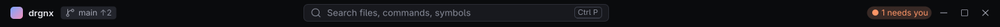
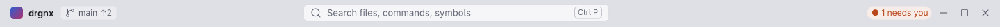

# Title row

The integrated top of the window, drawn by drgnx instead of the system's title bar: where you are, how to start, and
whether anything waits for you.

## Anatomy

Left to right, 38 px tall (34 compact, 42 roomy):

1. the **mark** and the project's name;
2. the **branch chip** (`main ↑2`): the branch and how far it is ahead of or behind its upstream;
3. in the middle, the **search box**: it opens Quick Open, and `>` typed first turns it into the command palette; its
   key is a keycap (`Ctrl P`);
4. at the right, the chips that appear only while they have something to say: `N need you` and `N agents`;
5. the window controls.

A double click on the row's empty part maximises or restores the window.

## Faces and tokens

The row is on the gap (`drgnx-surface-gap`); text is the UI role (`drgnx-ui-text`), the search box a keycap-and-field
on the quiet selection, the chips the chip faces ([chips](chips-and-keys.md)), and the project's name and the keys are bold (`drgnx-topline-strong`). The needs-you chip is `drgnx-status-attention`.

## Rules

- Nothing on the row moves when a chip appears or goes: the search box keeps its centre.
- When the frame is too narrow, the hint goes first and the project's name is cut with an ellipsis last; the row never
  wraps.
- `attention` appears once per place, never blinks, and never on the branch chip.
- The row is the UI font, never the code font.
