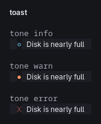
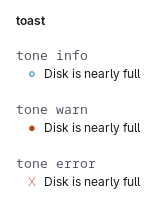
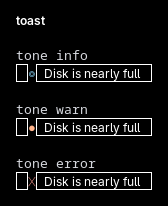

# Toast (kit)

<!-- Generated by `bin/drgnx design` from etc/ui/components.eld. Do not edit; change the source and regenerate. -->

The kit's `toast` component: one definition in `etc/ui/components.eld`, expanded the same way by the hub (`drgnx_rows::kit`) and by the Lisp chrome (`drgnx-ui-kit-expand`). Sizes are logical pixels; every colour is a [token](../tokens.md). Open it live with **Design: Component Catalogue**.

## Variants

- `tone`: `info`, `warn`, `error` (default `info`)

## Geometry

| Variant | Density | Height | Pad (start / end) | Gap | Box | Radius | Hit | Indent |
|---|---|---|---|---|---|---|---|---|
| info | compact | 0 | 12 / 12 | 8 | yes | 8 | 0 | - |
| info | comfortable | 0 | 12 / 12 | 8 | yes | 8 | 0 | - |
| info | roomy | 0 | 12 / 12 | 8 | yes | 8 | 0 | - |
| warn | compact | 0 | 12 / 12 | 8 | yes | 8 | 0 | - |
| warn | comfortable | 0 | 12 / 12 | 8 | yes | 8 | 0 | - |
| warn | roomy | 0 | 12 / 12 | 8 | yes | 8 | 0 | - |
| error | compact | 0 | 12 / 12 | 8 | yes | 8 | 0 | - |
| error | comfortable | 0 | 12 / 12 | 8 | yes | 8 | 0 | - |
| error | roomy | 0 | 12 / 12 | 8 | yes | 8 | 0 | - |

## On a terminal

- padding: 1 character(s) each side

## Spoken label

`(:by tone (info "information") (warn "warning") (error "error"))`

## Colours

| Binding | Face | Fill | Text | Edge |
|---|---|---|---|---|
| own | `drgnx-kit-toast` | overlay | fg | - |

## States

| State | Fill | Ring | Text | Face | Terminal |
|---|---|---|---|---|---|
| rest | the surface | - | unchanged | - | - |
| hover | `hover` | - | unchanged | `drgnx-hover` | none |
| pressed | `sel-quiet` | - | unchanged | `drgnx-selected-quiet` | - |
| selected | `sel`, radius 6 | - | unchanged | `drgnx-selected` | inverse |
| selected-inactive | `sel-inactive`, radius 6 | - | unchanged | `drgnx-selected-inactive` | underline |
| focus-visible | the surface | `focus`, 2 px inset | unchanged | `drgnx-focus` | inverse |
| disabled | the surface | - | `disabled` | `drgnx-text-disabled` | dim |
