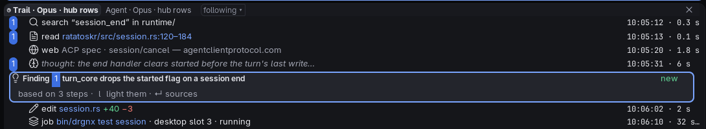
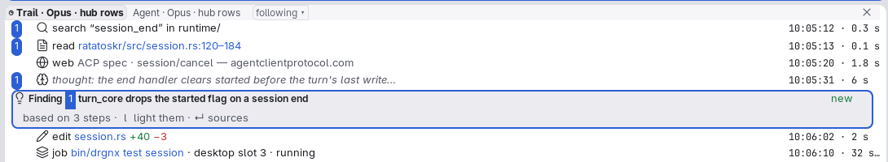

# Research trail

An agent's steps in order, newest at the bottom, following the end while it works.

## Anatomy

- A **step row** has the kind's [icon](../icons.md), a title (`path:120–184` for a read, the query for a search, the
  host and title of a page, `thinking` for a thought), and its time and duration at the right in caption text.
- The agent's decisions and findings stand among the steps as **cards** that say how many steps they are based on and
  which named sources no step of the session matches; a step a conclusion rests on carries that conclusion's number in
  a small pill (`drgnx-work-step-number`, the solid chip).
- It opens with the last 60 steps and fetches more when you scroll near the top.

## Faces and tokens

Rows use the list ladder ([Explorer](explorer.md)); the numbered pill is `drgnx-work-step-number`
(`drgnx-chip-solid`); finding cards are [cards of rows](cards.md); times are `drgnx-text-subtle` in the caption role.

## Rules

- A trail is a list: it keeps the list ladder and the sizes; it never invents its own row height.
- The end column (time, duration) is aligned by pixel, not by columns.
- Colour never carries a step's kind alone: the icon does too.
