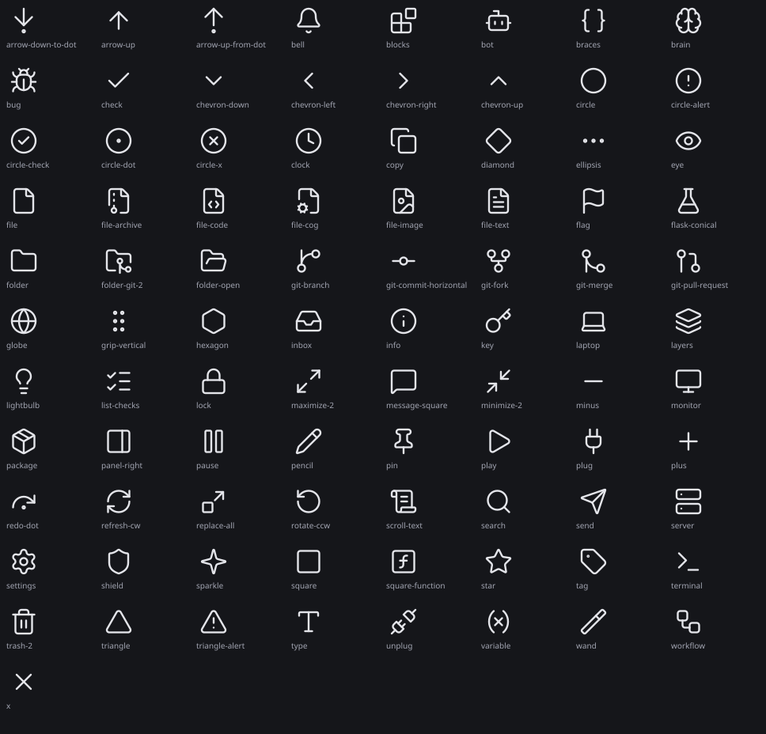
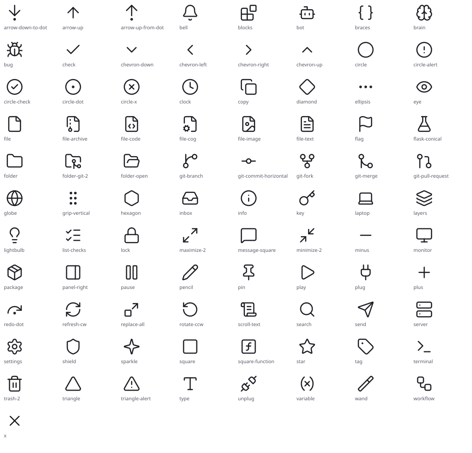

# Icons

<!-- Generated by `bin/drgnx design` from etc/icons and the Lisp that names them. Do not edit; change the source and regenerate. -->

drgnx's icons are [Lucide](https://lucide.dev) line icons (a few are Feather's), kept in `etc/icons/` as SVG with `currentColor`. Rules:

- 16 logical pixels (14 in dense rows), a stroke of 1.6 in the 24-unit box, sized through `drgnx-px`.
- An icon takes its colour from the face of the text around it (`drgnx-look-icon`): never a colour of its own, never a literal in the file.
- A terminal frame shows the glyph of the same name instead (`drgnx-face-glyphs`).
- A new icon is a file in `etc/icons/` named after what it shows, with the licence notice kept.

*Used in* lists the file kinds the Explorer and Quick Open give it (`etc/icons/files.eld`) and the Lisp files that name it near the word icon.

| Icon | Used in |
|---|---|
| `arrow-down-to-dot` | - |
| `arrow-up` | `modules/tools/drgnx-agent-panel-composer.el` |
| `arrow-up-from-dot` | - |
| `bell` | `core/drgnx-notice-toast.el`, `core/drgnx-palette.el` |
| `blocks` | - |
| `bot` | `core/drgnx-palette.el`, `modules/tools/drgnx-agent-panel-steps.el`, `modules/tools/drgnx-search-handoff.el` |
| `braces` | `modules/extra/drgnx-debug-memory.el` |
| `brain` | - |
| `bug` | `modules/extra/drgnx-debug-toolbar.el` |
| `check` | `modules/tools/drgnx-replace.el`, `modules/ui/drgnx-statusbar.el` |
| `chevron-down` | `modules/extra/drgnx-debug-console.el`, `modules/extra/drgnx-debug-toolbar.el`, `modules/extra/drgnx-debug-view.el`, `modules/tools/drgnx-replace.el`, `modules/ui/drgnx-look-bridge.el`, `wb/drgnx-explorer.el`, `wb/drgnx-wb.el` |
| `chevron-left` | - |
| `chevron-right` | `core/drgnx-palette.el`, `modules/tools/drgnx-replace.el`, `modules/ui/drgnx-look-bridge.el`, `wb/drgnx-explorer.el`, `wb/drgnx-wb.el` |
| `chevron-up` | - |
| `circle` | `core/drgnx-agent-identity.el` |
| `circle-alert` | - |
| `circle-check` | `modules/ui/drgnx-statusbar.el` |
| `circle-dot` | `core/drgnx-palette.el` |
| `circle-x` | `core/drgnx-notice-toast.el`, `modules/ui/drgnx-statusbar.el` |
| `clock` | - |
| `copy` | `modules/extra/drgnx-debug-share.el` |
| `diamond` | `core/drgnx-agent-identity.el` |
| `ellipsis` | `modules/tools/drgnx-agent-panel-steps.el`, `modules/tools/drgnx-work-map.el` |
| `eye` | `core/drgnx-palette.el` |
| `file` | `core/drgnx-icons.el`, `core/drgnx-palette.el`, `modules/tools/drgnx-replace.el`, `wb/drgnx-wb.el` |
| `file-archive` | file kind: 0 names, 15 extensions |
| `file-code` | file kind: 27 names, 114 extensions, `core/drgnx-palette.el`, `modules/tools/drgnx-agent-panel-cards.el` |
| `file-cog` | file kind: 25 names, 32 extensions |
| `file-image` | file kind: 0 names, 22 extensions |
| `file-text` | file kind: 14 names, 22 extensions |
| `flag` | - |
| `flask-conical` | - |
| `folder` | `core/drgnx-icons.el`, `core/drgnx-palette.el`, `wb/drgnx-explorer.el` |
| `folder-git-2` | - |
| `folder-open` | `core/drgnx-icons.el`, `wb/drgnx-explorer.el` |
| `git-branch` | `core/drgnx-palette.el`, `modules/ui/drgnx-statusbar.el` |
| `git-commit-horizontal` | - |
| `git-fork` | `modules/tools/drgnx-agent-panel-composer.el`, `modules/tools/drgnx-search-handoff.el` |
| `git-merge` | - |
| `git-pull-request` | - |
| `globe` | - |
| `grip-vertical` | `modules/extra/drgnx-debug-toolbar.el`, `modules/tools/drgnx-work-map.el` |
| `hexagon` | - |
| `inbox` | `modules/extra/drgnx-debug-timeline.el` |
| `info` | `core/drgnx-notice-toast.el`, `core/drgnx-palette.el`, `wb/drgnx-outline.el` |
| `key` | `wb/drgnx-chrome.el` |
| `laptop` | - |
| `layers` | `core/drgnx-palette.el`, `modules/tools/drgnx-jobs.el` |
| `lightbulb` | - |
| `list-checks` | `core/drgnx-palette.el` |
| `lock` | - |
| `maximize-2` | - |
| `message-square` | - |
| `minimize-2` | - |
| `minus` | `modules/tools/drgnx-replace.el` |
| `monitor` | - |
| `package` | - |
| `panel-right` | `core/drgnx-palette.el` |
| `pause` | `modules/tools/drgnx-agent-panel-composer.el` |
| `pencil` | `core/drgnx-palette.el` |
| `pin` | `modules/tools/drgnx-agent-panel-steps.el` |
| `play` | `core/drgnx-palette.el`, `modules/extra/drgnx-debug-toolbar.el`, `modules/extra/drgnx-debug-view.el` |
| `plug` | - |
| `plus` | - |
| `redo-dot` | - |
| `refresh-cw` | `core/drgnx-shell-env.el` |
| `replace-all` | `modules/tools/drgnx-replace.el` |
| `rotate-ccw` | `core/drgnx-config.el`, `modules/tools/drgnx-work-space.el` |
| `scroll-text` | - |
| `search` | `core/drgnx-palette-frame.el`, `core/drgnx-palette.el`, `modules/ui/drgnx-topline.el` |
| `send` | - |
| `server` | `modules/tools/drgnx-term.el` |
| `settings` | `core/drgnx-palette.el` |
| `shield` | `modules/tools/drgnx-agent-panel-cards.el`, `modules/ui/drgnx-statusbar.el` |
| `sparkle` | `modules/tools/drgnx-agent-panel-composer.el` |
| `square` | `core/drgnx-agent-identity.el`, `modules/tools/drgnx-replace.el`, `modules/ui/drgnx-topline.el` |
| `square-function` | - |
| `star` | - |
| `tag` | - |
| `terminal` | `core/drgnx-palette.el`, `modules/extra/drgnx-debug-disassembly.el`, `modules/extra/drgnx-debug.el` |
| `trash-2` | `modules/extra/drgnx-debug-console.el` |
| `triangle` | `core/drgnx-agent-identity.el` |
| `triangle-alert` | `core/drgnx-notice-toast.el`, `modules/extra/drgnx-debug-share.el`, `modules/ui/drgnx-statusbar.el` |
| `type` | - |
| `unplug` | - |
| `variable` | - |
| `wand` | - |
| `workflow` | `modules/extra/drgnx-debug-heap.el` |
| `x` | `modules/ui/drgnx-topline.el`, `wb/drgnx-area.el`, `wb/drgnx-chrome.el` |
