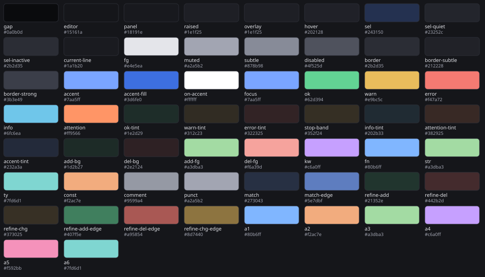
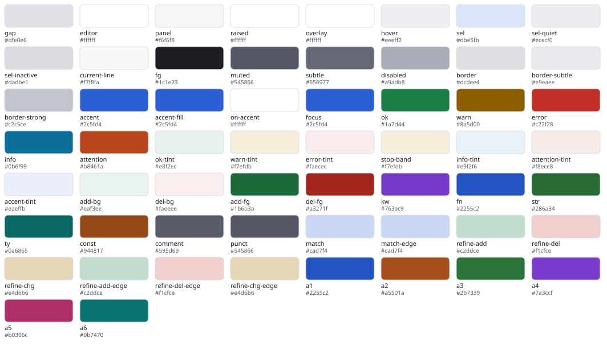
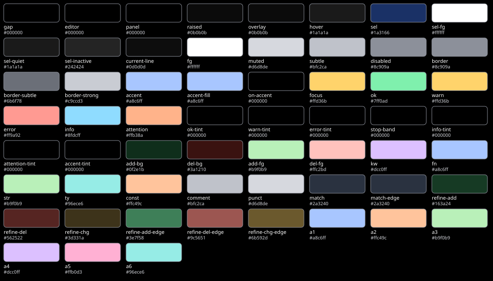

# Colour tokens

<!-- Generated by `bin/drgnx design` from themes/drgnx-tokens.eld. Do not edit; change the source and regenerate. -->

Every colour drgnx draws is one of these tokens, in one of three variants. A face names a token (never a colour), a theme turns the token table into faces, and nothing outside `themes/` holds a colour literal. *Definition* says how the table builds a token: a tint is a colour at an alpha over the editor surface. *Faces* are the faces the theme generator gives the token to; faces that inherit them (the semantic ones) carry the colour further, see [faces](../guide/face.md). The same values, as CSS custom properties, are in [tokens.css](tokens.css).

## Dark

| Token | Value | Definition | Faces |
|---|---|---|---|
| `gap` | `#0a0b0d` | fixed | `drgnx-surface-gap`, `drgnx-work-lens-rail`, `mode-line`, `mode-line-active`, `mode-line-inactive`, `tab-bar`, `drgnx-topline-strong`, `window-divider`, `window-divider-first-pixel`, `window-divider-last-pixel`, `internal-border`, `child-frame-shadow`, `nidhogg-title-bar`, `nidhogg-title-bar-inactive`, `ansi-color-black` |
| `editor` | `#15161a` | fixed | `drgnx-work-who-1`, `drgnx-work-who-2`, `drgnx-work-who-3`, `drgnx-work-who-4`, `drgnx-work-who-5`, `drgnx-work-who-6`, `default`, `fringe`, `header-line`, `tab-bar-tab`, `tab-line-tab`, `tab-line-tab-current` |
| `panel` | `#18191e` | fixed | `drgnx-surface-panel`, `drgnx-control-hidden`, `tab-bar-tab-inactive`, `tab-line`, `tab-line-tab-inactive`, `tab-line-tab-special`, `drgnx-wb-tab`, `ansi-color-bright-black` |
| `raised` | `#1e1f25` | fixed | `drgnx-surface-raised`, `tooltip`, `drgnx-debug-exception-card`, `diff-header` |
| `overlay` | `#1e1f25` | fixed | `drgnx-surface-overlay` |
| `hover` | `#202128` | fixed | `drgnx-hover`, `highlight`, `mode-line-highlight`, `header-line-highlight`, `tab-line-highlight`, `drgnx-ruler-view`, `eglot-highlight-symbol-face` |
| `sel` | `#243150` | fixed | `drgnx-selected`, `region`, `completions-highlight`, `drgnx-replace-sheet-selected` |
| `sel-quiet` | `#23252c` | fixed | `drgnx-selected-quiet`, `drgnx-chip-quiet`, `drgnx-control`, `drgnx-pill-on`, `secondary-selection`, `drgnx-wb-tab-current`, `drgnx-replace-preview-head` |
| `sel-inactive` | `#2b2d35` | fixed | `drgnx-selected-inactive` |
| `current-line` | `#1a1b20` | fixed | `hl-line`, `line-number-current-line` |
| `fg` | `#e4e5ea` | fixed | `drgnx-control`, `drgnx-pill-on`, `default`, `line-number-current-line`, `font-lock-variable-name-face`, `font-lock-variable-use-face`, `font-lock-property-name-face`, `font-lock-property-use-face`, `mode-line`, `mode-line-active`, `mode-line-buffer-id`, `drgnx-topline-strong`, `tab-bar-tab`, `tab-line-tab`, `tab-line-tab-current`, `drgnx-wb-tab-current`, `tooltip`, `nidhogg-title-bar`, `completions-first-difference`, `diff-file-header`, `ansi-color-white`, `ansi-color-bright-white` |
| `muted` | `#a2a5b2` | fixed | `drgnx-text-muted`, `drgnx-chip-quiet`, `drgnx-work-flow-button-key`, `shadow`, `mode-line-inactive`, `header-line`, `tab-bar`, `tab-bar-tab-inactive`, `tab-line`, `tab-line-tab-inactive`, `tab-line-tab-special`, `drgnx-wb-tab`, `nidhogg-title-bar-inactive`, `drgnx-replace-preview-head`, `diff-header`, `diff-context`, `vc-state-base` |
| `subtle` | `#878b98` | fixed | `drgnx-text-subtle`, `drgnx-pill`, `drgnx-keycap`, `fringe`, `line-number`, `completions-annotations`, `flymake-end-of-line-diagnostics-face`, `eglot-inlay-hint-face`, `eglot-diagnostic-tag-unnecessary-face` |
| `disabled` | `#4f525d` | fixed | `drgnx-text-disabled`, `drgnx-debug-ruler-unverified` |
| `border` | `#2b2d35` | fixed | `drgnx-border`, `drgnx-palette-footer`, `drgnx-control`, `drgnx-pill`, `drgnx-pill-on`, `drgnx-work-flow-button`, `vertical-border`, `drgnx-replace-sheet-rule` |
| `border-subtle` | `#212228` | fixed | `drgnx-border-subtle` |
| `border-strong` | `#3b3e49` | fixed | `drgnx-border-strong`, `drgnx-keycap`, `drgnx-card-top`, `drgnx-card-mid`, `drgnx-card-bottom`, `drgnx-card-single`, `drgnx-work-lens-current`, `child-frame-border` |
| `accent` | `#7aa5ff` | fixed | `drgnx-accent`, `drgnx-chip-accent`, `drgnx-pill-accent`, `cursor`, `drgnx-card-sel-top`, `drgnx-card-sel-mid`, `drgnx-card-sel-bottom`, `drgnx-card-sel-single`, `link`, `link-visited`, `mode-line-emphasis`, `tab-line-close-highlight`, `minibuffer-prompt`, `isearch`, `completions-common-part`, `eglot-mode-line`, `outline-6` |
| `accent-fill` | `#3d6fe0` | fixed | `drgnx-chip-solid`, `drgnx-control-primary`, `drgnx-work-flow-button-primary` |
| `on-accent` | `#ffffff` | fixed | `drgnx-chip-solid`, `drgnx-control-primary`, `drgnx-work-flow-key-primary`, `drgnx-replace-tick-mark`, `drgnx-replace-sheet-key` |
| `focus` | `#7aa5ff` | fixed | `drgnx-focus`, `drgnx-focus-line`, `drgnx-replace-sheet-selected` |
| `ok` | `#62d394` | fixed | `drgnx-status-ok`, `drgnx-chip-ok`, `success`, `vc-up-to-date-state`, `vc-locally-added-state`, `outline-7`, `ansi-color-green` |
| `warn` | `#e9bc5c` | fixed | `drgnx-status-warn`, `drgnx-chip-warn`, `warning`, `font-lock-warning-face`, `drgnx-debug-ruler-stop`, `vc-edited-state`, `flymake-warning`, `flymake-warning-echo`, `flymake-warning-echo-at-eol`, `flymake-warning-inline`, `ansi-color-yellow` |
| `error` | `#f47a72` | fixed | `drgnx-status-fail`, `drgnx-chip-error`, `error`, `show-paren-mismatch`, `drgnx-debug-ruler-breakpoint`, `drgnx-debug-exception-card`, `vc-conflict-state`, `vc-missing-state`, `vc-removed-state`, `flymake-error`, `flymake-error-echo`, `flymake-error-echo-at-eol`, `flymake-error-inline`, `ansi-color-red` |
| `info` | `#6fc6ea` | fixed | `drgnx-status-info`, `diff-hunk-header`, `vc-needs-update-state`, `flymake-note`, `flymake-note-echo`, `flymake-note-echo-at-eol`, `flymake-note-inline`, `outline-8`, `ansi-color-blue` |
| `attention` | `#ff9566` | fixed | `drgnx-status-attention`, `drgnx-chip-attention`, `drgnx-agent-panel-perm-head` |
| `ok-tint` | `#1e2d29` | `ok` at 12 % over `editor` | `drgnx-chip-ok`, `drgnx-debug-frame-line` |
| `warn-tint` | `#312c23` | `warn` at 13 % over `editor` | `drgnx-chip-warn`, `drgnx-tint-warn`, `diff-changed`, `flymake-warning-echo-at-eol`, `flymake-warning-inline` |
| `error-tint` | `#322325` | `error` at 13 % over `editor` | `drgnx-chip-error`, `show-paren-mismatch`, `drgnx-debug-exception-line`, `flymake-error-echo-at-eol`, `flymake-error-inline` |
| `stop-band` | `#352f24` | `warn` at 15 % over `editor` | `drgnx-debug-stopped-line` |
| `info-tint` | `#202b33` | `info` at 12 % over `editor` | `flymake-note-echo-at-eol`, `flymake-note-inline` |
| `attention-tint` | `#382925` | `attention` at 15 % over `editor` | `drgnx-chip-attention` |
| `accent-tint` | `#232a3a` | `accent` at 14.000000000000002 % over `editor` | `drgnx-chip-accent`, `drgnx-pill-accent`, `match`, `show-paren-match` |
| `add-bg` | `#1d2b27` | `ok` at 11 % over `editor` | `diff-added` |
| `del-bg` | `#2e2124` | `error` at 11 % over `editor` | `diff-removed` |
| `add-fg` | `#a3dba3` | fixed | `diff-added`, `drgnx-replace-plus`, `diff-indicator-added` |
| `del-fg` | `#f6a39d` | fixed | `diff-removed`, `drgnx-replace-minus`, `diff-indicator-removed` |
| `kw` | `#c6a0ff` | fixed | `font-lock-keyword-face`, `font-lock-builtin-face`, `font-lock-preprocessor-face`, `outline-1`, `ansi-color-magenta` |
| `fn` | `#80b6ff` | fixed | `font-lock-function-name-face`, `font-lock-function-call-face`, `sh-quoted-exec`, `outline-2` |
| `str` | `#a3dba3` | fixed | `font-lock-string-face`, `font-lock-doc-face`, `sh-heredoc`, `outline-3` |
| `ty` | `#7fd6d1` | fixed | `font-lock-type-face`, `font-lock-doc-markup-face`, `outline-4`, `ansi-color-cyan` |
| `const` | `#f2ac7e` | fixed | `font-lock-constant-face`, `font-lock-number-face`, `font-lock-escape-face`, `font-lock-regexp-grouping-backslash`, `font-lock-regexp-grouping-construct`, `outline-5` |
| `comment` | `#9599a4` | fixed | `font-lock-comment-face`, `font-lock-comment-delimiter-face` |
| `punct` | `#a2a5b2` | fixed | `font-lock-punctuation-face`, `font-lock-bracket-face`, `font-lock-delimiter-face`, `font-lock-operator-face`, `font-lock-misc-punctuation-face`, `font-lock-negation-char-face` |
| `match` | `#273043` | `accent` at 18 % over `editor` | `isearch`, `lazy-highlight` |
| `match-edge` | `#5e7dbf` | `accent` at 72 % over `editor` | `lazy-highlight` |
| `refine-add` | `#21352e` | `ok` at 6 % over `add-bg` | `diff-refine-added` |
| `refine-del` | `#442b2d` | `error` at 11 % over `del-bg` | `diff-refine-removed` |
| `refine-chg` | `#373025` | `warn` at 3 % over `warn-tint` | `diff-refine-changed` |
| `refine-add-edge` | `#407f5e` | `ok` at 50 % over `add-bg` | `diff-refine-added` |
| `refine-del-edge` | `#a95854` | `error` at 62 % over `del-bg` | `diff-refine-removed` |
| `refine-chg-edge` | `#8d7440` | `warn` at 50 % over `warn-tint` | `diff-refine-changed` |
| `a1` | `#80b6ff` | fixed | `drgnx-agent-1`, `drgnx-work-who-1` |
| `a2` | `#f2ac7e` | fixed | `drgnx-agent-2`, `drgnx-work-who-2` |
| `a3` | `#a3dba3` | fixed | `drgnx-agent-3`, `drgnx-work-who-3` |
| `a4` | `#c6a0ff` | fixed | `drgnx-agent-4`, `drgnx-work-who-4` |
| `a5` | `#f592bb` | fixed | `drgnx-agent-5`, `drgnx-work-who-5` |
| `a6` | `#7fd6d1` | fixed | `drgnx-agent-6`, `drgnx-work-who-6` |

## Light

| Token | Value | Definition | Faces |
|---|---|---|---|
| `gap` | `#dfe0e6` | fixed | `drgnx-surface-gap`, `drgnx-work-lens-rail`, `mode-line`, `mode-line-active`, `mode-line-inactive`, `tab-bar`, `drgnx-topline-strong`, `window-divider`, `window-divider-first-pixel`, `window-divider-last-pixel`, `internal-border`, `child-frame-shadow`, `nidhogg-title-bar`, `nidhogg-title-bar-inactive`, `ansi-color-black` |
| `editor` | `#ffffff` | fixed | `drgnx-work-who-1`, `drgnx-work-who-2`, `drgnx-work-who-3`, `drgnx-work-who-4`, `drgnx-work-who-5`, `drgnx-work-who-6`, `default`, `fringe`, `header-line`, `tab-bar-tab`, `tab-line-tab`, `tab-line-tab-current` |
| `panel` | `#f6f6f8` | fixed | `drgnx-surface-panel`, `drgnx-control-hidden`, `tab-bar-tab-inactive`, `tab-line`, `tab-line-tab-inactive`, `tab-line-tab-special`, `drgnx-wb-tab`, `ansi-color-bright-black` |
| `raised` | `#ffffff` | fixed | `drgnx-surface-raised`, `tooltip`, `drgnx-debug-exception-card`, `diff-header` |
| `overlay` | `#ffffff` | fixed | `drgnx-surface-overlay` |
| `hover` | `#eeeff2` | fixed | `drgnx-hover`, `highlight`, `mode-line-highlight`, `header-line-highlight`, `tab-line-highlight`, `drgnx-ruler-view`, `eglot-highlight-symbol-face` |
| `sel` | `#dbe5fb` | fixed | `drgnx-selected`, `region`, `completions-highlight`, `drgnx-replace-sheet-selected` |
| `sel-quiet` | `#ececf0` | fixed | `drgnx-selected-quiet`, `drgnx-chip-quiet`, `drgnx-control`, `drgnx-pill-on`, `secondary-selection`, `drgnx-wb-tab-current`, `drgnx-replace-preview-head` |
| `sel-inactive` | `#dadbe1` | fixed | `drgnx-selected-inactive` |
| `current-line` | `#f7f8fa` | fixed | `hl-line`, `line-number-current-line` |
| `fg` | `#1c1e23` | fixed | `drgnx-control`, `drgnx-pill-on`, `default`, `line-number-current-line`, `font-lock-variable-name-face`, `font-lock-variable-use-face`, `font-lock-property-name-face`, `font-lock-property-use-face`, `mode-line`, `mode-line-active`, `mode-line-buffer-id`, `drgnx-topline-strong`, `tab-bar-tab`, `tab-line-tab`, `tab-line-tab-current`, `drgnx-wb-tab-current`, `tooltip`, `nidhogg-title-bar`, `completions-first-difference`, `diff-file-header`, `ansi-color-white`, `ansi-color-bright-white` |
| `muted` | `#545866` | fixed | `drgnx-text-muted`, `drgnx-chip-quiet`, `drgnx-work-flow-button-key`, `shadow`, `mode-line-inactive`, `header-line`, `tab-bar`, `tab-bar-tab-inactive`, `tab-line`, `tab-line-tab-inactive`, `tab-line-tab-special`, `drgnx-wb-tab`, `nidhogg-title-bar-inactive`, `drgnx-replace-preview-head`, `diff-header`, `diff-context`, `vc-state-base` |
| `subtle` | `#656977` | fixed | `drgnx-text-subtle`, `drgnx-pill`, `drgnx-keycap`, `fringe`, `line-number`, `completions-annotations`, `flymake-end-of-line-diagnostics-face`, `eglot-inlay-hint-face`, `eglot-diagnostic-tag-unnecessary-face` |
| `disabled` | `#a9adb8` | fixed | `drgnx-text-disabled`, `drgnx-debug-ruler-unverified` |
| `border` | `#dcdee4` | fixed | `drgnx-border`, `drgnx-palette-footer`, `drgnx-control`, `drgnx-pill`, `drgnx-pill-on`, `drgnx-work-flow-button`, `vertical-border`, `drgnx-replace-sheet-rule` |
| `border-subtle` | `#e9eaee` | fixed | `drgnx-border-subtle` |
| `border-strong` | `#c2c5ce` | fixed | `drgnx-border-strong`, `drgnx-keycap`, `drgnx-card-top`, `drgnx-card-mid`, `drgnx-card-bottom`, `drgnx-card-single`, `drgnx-work-lens-current`, `child-frame-border` |
| `accent` | `#2c5fd4` | fixed | `drgnx-accent`, `drgnx-chip-accent`, `drgnx-pill-accent`, `cursor`, `drgnx-card-sel-top`, `drgnx-card-sel-mid`, `drgnx-card-sel-bottom`, `drgnx-card-sel-single`, `link`, `link-visited`, `mode-line-emphasis`, `tab-line-close-highlight`, `minibuffer-prompt`, `isearch`, `completions-common-part`, `eglot-mode-line`, `outline-6` |
| `accent-fill` | `#2c5fd4` | fixed | `drgnx-chip-solid`, `drgnx-control-primary`, `drgnx-work-flow-button-primary` |
| `on-accent` | `#ffffff` | fixed | `drgnx-chip-solid`, `drgnx-control-primary`, `drgnx-work-flow-key-primary`, `drgnx-replace-tick-mark`, `drgnx-replace-sheet-key` |
| `focus` | `#2c5fd4` | fixed | `drgnx-focus`, `drgnx-focus-line`, `drgnx-replace-sheet-selected` |
| `ok` | `#1a7d44` | fixed | `drgnx-status-ok`, `drgnx-chip-ok`, `success`, `vc-up-to-date-state`, `vc-locally-added-state`, `outline-7`, `ansi-color-green` |
| `warn` | `#8a5d00` | fixed | `drgnx-status-warn`, `drgnx-chip-warn`, `warning`, `font-lock-warning-face`, `drgnx-debug-ruler-stop`, `vc-edited-state`, `flymake-warning`, `flymake-warning-echo`, `flymake-warning-echo-at-eol`, `flymake-warning-inline`, `ansi-color-yellow` |
| `error` | `#c22f28` | fixed | `drgnx-status-fail`, `drgnx-chip-error`, `error`, `show-paren-mismatch`, `drgnx-debug-ruler-breakpoint`, `drgnx-debug-exception-card`, `vc-conflict-state`, `vc-missing-state`, `vc-removed-state`, `flymake-error`, `flymake-error-echo`, `flymake-error-echo-at-eol`, `flymake-error-inline`, `ansi-color-red` |
| `info` | `#0b6f99` | fixed | `drgnx-status-info`, `diff-hunk-header`, `vc-needs-update-state`, `flymake-note`, `flymake-note-echo`, `flymake-note-echo-at-eol`, `flymake-note-inline`, `outline-8`, `ansi-color-blue` |
| `attention` | `#b8461a` | fixed | `drgnx-status-attention`, `drgnx-chip-attention`, `drgnx-agent-panel-perm-head` |
| `ok-tint` | `#e8f2ec` | `ok` at 10 % over `editor` | `drgnx-chip-ok`, `drgnx-debug-frame-line` |
| `warn-tint` | `#f7efdb` | `#c48c00` at 14.000000000000002 % over `editor` | `drgnx-chip-warn`, `drgnx-tint-warn`, `diff-changed`, `flymake-warning-echo-at-eol`, `flymake-warning-inline` |
| `error-tint` | `#faecec` | `error` at 9 % over `editor` | `drgnx-chip-error`, `show-paren-mismatch`, `drgnx-debug-exception-line`, `flymake-error-echo-at-eol`, `flymake-error-inline` |
| `stop-band` | `#f7efdb` | the colour of `warn-tint` | `drgnx-debug-stopped-line` |
| `info-tint` | `#e9f2f6` | `info` at 9 % over `editor` | `flymake-note-echo-at-eol`, `flymake-note-inline` |
| `attention-tint` | `#f8ece8` | `attention` at 10 % over `editor` | `drgnx-chip-attention` |
| `accent-tint` | `#eaeffb` | `accent` at 10 % over `editor` | `drgnx-chip-accent`, `drgnx-pill-accent`, `match`, `show-paren-match` |
| `add-bg` | `#eaf3ee` | `ok` at 9 % over `editor` | `diff-added` |
| `del-bg` | `#faeeee` | `error` at 8 % over `editor` | `diff-removed` |
| `add-fg` | `#1b6b3a` | fixed | `diff-added`, `drgnx-replace-plus`, `diff-indicator-added` |
| `del-fg` | `#a3271f` | fixed | `diff-removed`, `drgnx-replace-minus`, `diff-indicator-removed` |
| `kw` | `#763ac9` | fixed | `font-lock-keyword-face`, `font-lock-builtin-face`, `font-lock-preprocessor-face`, `outline-1`, `ansi-color-magenta` |
| `fn` | `#2255c2` | fixed | `font-lock-function-name-face`, `font-lock-function-call-face`, `sh-quoted-exec`, `outline-2` |
| `str` | `#286a34` | fixed | `font-lock-string-face`, `font-lock-doc-face`, `sh-heredoc`, `outline-3` |
| `ty` | `#0a6865` | fixed | `font-lock-type-face`, `font-lock-doc-markup-face`, `outline-4`, `ansi-color-cyan` |
| `const` | `#944817` | fixed | `font-lock-constant-face`, `font-lock-number-face`, `font-lock-escape-face`, `font-lock-regexp-grouping-backslash`, `font-lock-regexp-grouping-construct`, `outline-5` |
| `comment` | `#595d69` | fixed | `font-lock-comment-face`, `font-lock-comment-delimiter-face` |
| `punct` | `#545866` | fixed | `font-lock-punctuation-face`, `font-lock-bracket-face`, `font-lock-delimiter-face`, `font-lock-operator-face`, `font-lock-misc-punctuation-face`, `font-lock-negation-char-face` |
| `match` | `#cad7f4` | `accent` at 25 % over `editor` | `isearch`, `lazy-highlight` |
| `match-edge` | `#cad7f4` | `accent` at 25 % over `editor` | `lazy-highlight` |
| `refine-add` | `#c2ddce` | `ok` at 19 % over `add-bg` | `diff-refine-added` |
| `refine-del` | `#f1cfce` | `error` at 16 % over `del-bg` | `diff-refine-removed` |
| `refine-chg` | `#e4d6b6` | `warn` at 17 % over `warn-tint` | `diff-refine-changed` |
| `refine-add-edge` | `#c2ddce` | the colour of `refine-add` | `diff-refine-added` |
| `refine-del-edge` | `#f1cfce` | the colour of `refine-del` | `diff-refine-removed` |
| `refine-chg-edge` | `#e4d6b6` | the colour of `refine-chg` | `diff-refine-changed` |
| `a1` | `#2255c2` | fixed | `drgnx-agent-1`, `drgnx-work-who-1` |
| `a2` | `#a5501a` | fixed | `drgnx-agent-2`, `drgnx-work-who-2` |
| `a3` | `#2b7339` | fixed | `drgnx-agent-3`, `drgnx-work-who-3` |
| `a4` | `#7a3ccf` | fixed | `drgnx-agent-4`, `drgnx-work-who-4` |
| `a5` | `#b0306c` | fixed | `drgnx-agent-5`, `drgnx-work-who-5` |
| `a6` | `#0b7470` | fixed | `drgnx-agent-6`, `drgnx-work-who-6` |

## High contrast

| Token | Value | Definition | Faces |
|---|---|---|---|
| `gap` | `#000000` | fixed | `drgnx-surface-gap`, `drgnx-work-lens-rail`, `mode-line`, `mode-line-active`, `mode-line-inactive`, `tab-bar`, `drgnx-topline-strong`, `window-divider`, `window-divider-first-pixel`, `window-divider-last-pixel`, `internal-border`, `nidhogg-title-bar`, `nidhogg-title-bar-inactive`, `ansi-color-black` |
| `editor` | `#000000` | fixed | `drgnx-work-who-1`, `drgnx-work-who-2`, `drgnx-work-who-3`, `drgnx-work-who-4`, `drgnx-work-who-5`, `drgnx-work-who-6`, `default`, `fringe`, `header-line`, `tab-bar-tab`, `tab-line-tab`, `tab-line-tab-current` |
| `panel` | `#000000` | fixed | `drgnx-surface-panel`, `drgnx-control-hidden`, `tab-bar-tab-inactive`, `tab-line`, `tab-line-tab-inactive`, `tab-line-tab-special`, `drgnx-wb-tab`, `ansi-color-bright-black` |
| `raised` | `#0b0b0b` | fixed | `drgnx-surface-raised`, `tooltip`, `drgnx-debug-exception-card`, `diff-header` |
| `overlay` | `#0b0b0b` | fixed | `drgnx-surface-overlay` |
| `hover` | `#1a1a1a` | fixed | `drgnx-hover`, `highlight`, `mode-line-highlight`, `header-line-highlight`, `tab-line-highlight`, `drgnx-ruler-view`, `eglot-highlight-symbol-face` |
| `sel` | `#1a3166` | fixed | `drgnx-selected`, `region`, `completions-highlight`, `drgnx-replace-sheet-selected` |
| `sel-fg` | `#ffffff` | fixed | `drgnx-selected`, `drgnx-selected-secondary`, `region` |
| `sel-quiet` | `#1a1a1a` | fixed | `drgnx-selected-quiet`, `drgnx-chip-quiet`, `drgnx-control`, `drgnx-pill-on`, `secondary-selection`, `drgnx-wb-tab-current`, `drgnx-replace-preview-head` |
| `sel-inactive` | `#242424` | fixed | `drgnx-selected-inactive` |
| `current-line` | `#0d0d0d` | fixed | `hl-line`, `line-number-current-line` |
| `fg` | `#ffffff` | fixed | `drgnx-control`, `drgnx-pill-on`, `default`, `line-number-current-line`, `font-lock-variable-name-face`, `font-lock-variable-use-face`, `font-lock-property-name-face`, `font-lock-property-use-face`, `mode-line`, `mode-line-active`, `mode-line-buffer-id`, `drgnx-topline-strong`, `tab-bar-tab`, `tab-line-tab`, `tab-line-tab-current`, `drgnx-wb-tab-current`, `tooltip`, `nidhogg-title-bar`, `completions-first-difference`, `diff-file-header`, `ansi-color-white`, `ansi-color-bright-white` |
| `muted` | `#d6d8de` | fixed | `drgnx-text-muted`, `drgnx-chip-quiet`, `drgnx-work-flow-button-key`, `shadow`, `mode-line-inactive`, `header-line`, `tab-bar`, `tab-bar-tab-inactive`, `tab-line`, `tab-line-tab-inactive`, `tab-line-tab-special`, `drgnx-wb-tab`, `nidhogg-title-bar-inactive`, `drgnx-replace-preview-head`, `diff-header`, `diff-context`, `vc-state-base` |
| `subtle` | `#bfc2ca` | fixed | `drgnx-text-subtle`, `drgnx-pill`, `drgnx-keycap`, `fringe`, `line-number`, `completions-annotations`, `flymake-end-of-line-diagnostics-face`, `eglot-inlay-hint-face`, `eglot-diagnostic-tag-unnecessary-face` |
| `disabled` | `#8c909a` | fixed | `drgnx-text-disabled`, `drgnx-debug-ruler-unverified` |
| `border` | `#8c909a` | fixed | `drgnx-border`, `drgnx-palette-footer`, `drgnx-control`, `drgnx-pill`, `drgnx-pill-on`, `drgnx-work-flow-button`, `vertical-border`, `drgnx-replace-sheet-rule` |
| `border-subtle` | `#6b6f78` | fixed | `drgnx-border-subtle` |
| `border-strong` | `#c9ccd3` | fixed | `drgnx-border-strong`, `drgnx-keycap`, `drgnx-card-top`, `drgnx-card-mid`, `drgnx-card-bottom`, `drgnx-card-single`, `drgnx-work-lens-current`, `child-frame-border` |
| `accent` | `#a8c6ff` | fixed | `drgnx-accent`, `drgnx-chip-accent`, `drgnx-pill-accent`, `cursor`, `drgnx-card-sel-top`, `drgnx-card-sel-mid`, `drgnx-card-sel-bottom`, `drgnx-card-sel-single`, `link`, `link-visited`, `mode-line-emphasis`, `tab-line-close-highlight`, `minibuffer-prompt`, `isearch`, `completions-common-part`, `eglot-mode-line`, `outline-6` |
| `accent-fill` | `#a8c6ff` | fixed | `drgnx-chip-solid`, `drgnx-control-primary`, `drgnx-work-flow-button-primary` |
| `on-accent` | `#000000` | fixed | `drgnx-chip-solid`, `drgnx-control-primary`, `drgnx-work-flow-key-primary`, `drgnx-replace-tick-mark`, `drgnx-replace-sheet-key` |
| `focus` | `#ffd36b` | fixed | `drgnx-focus`, `drgnx-focus-line`, `drgnx-replace-sheet-selected` |
| `ok` | `#7ff0ad` | fixed | `drgnx-status-ok`, `drgnx-chip-ok`, `success`, `vc-up-to-date-state`, `vc-locally-added-state`, `outline-7`, `ansi-color-green` |
| `warn` | `#ffd36b` | fixed | `drgnx-status-warn`, `drgnx-chip-warn`, `drgnx-tint-warn`, `warning`, `font-lock-warning-face`, `drgnx-debug-ruler-stop`, `vc-edited-state`, `flymake-warning`, `flymake-warning-echo`, `flymake-warning-echo-at-eol`, `flymake-warning-inline`, `ansi-color-yellow` |
| `error` | `#ff9a92` | fixed | `drgnx-status-fail`, `drgnx-chip-error`, `error`, `show-paren-mismatch`, `drgnx-debug-ruler-breakpoint`, `drgnx-debug-exception-card`, `vc-conflict-state`, `vc-missing-state`, `vc-removed-state`, `flymake-error`, `flymake-error-echo`, `flymake-error-echo-at-eol`, `flymake-error-inline`, `ansi-color-red` |
| `info` | `#8fdcff` | fixed | `drgnx-status-info`, `diff-hunk-header`, `vc-needs-update-state`, `flymake-note`, `flymake-note-echo`, `flymake-note-echo-at-eol`, `flymake-note-inline`, `outline-8`, `ansi-color-blue` |
| `attention` | `#ffb38a` | fixed | `drgnx-status-attention`, `drgnx-chip-attention`, `drgnx-agent-panel-perm-head` |
| `ok-tint` | `#000000` | `ok` at 0 % over `editor` | `drgnx-chip-ok`, `drgnx-debug-frame-line` |
| `warn-tint` | `#000000` | `warn` at 0 % over `editor` | `drgnx-chip-warn`, `drgnx-tint-warn`, `diff-changed` |
| `error-tint` | `#000000` | `error` at 0 % over `editor` | `drgnx-chip-error`, `show-paren-mismatch`, `drgnx-debug-exception-line` |
| `stop-band` | `#000000` | the colour of `warn-tint` | `drgnx-debug-stopped-line` |
| `info-tint` | `#000000` | `info` at 0 % over `editor` | - |
| `attention-tint` | `#000000` | `attention` at 0 % over `editor` | `drgnx-chip-attention` |
| `accent-tint` | `#000000` | `accent` at 0 % over `editor` | `drgnx-chip-accent`, `drgnx-pill-accent`, `match`, `show-paren-match` |
| `add-bg` | `#0f2e1b` | fixed | `diff-added` |
| `del-bg` | `#3a1210` | fixed | `diff-removed` |
| `add-fg` | `#b9f0b9` | fixed | `diff-added`, `drgnx-replace-plus`, `diff-indicator-added` |
| `del-fg` | `#ffc2bd` | fixed | `diff-removed`, `drgnx-replace-minus`, `diff-indicator-removed` |
| `kw` | `#dcc0ff` | fixed | `font-lock-keyword-face`, `font-lock-builtin-face`, `font-lock-preprocessor-face`, `outline-1`, `ansi-color-magenta` |
| `fn` | `#a8c6ff` | fixed | `font-lock-function-name-face`, `font-lock-function-call-face`, `sh-quoted-exec`, `outline-2` |
| `str` | `#b9f0b9` | fixed | `font-lock-string-face`, `font-lock-doc-face`, `sh-heredoc`, `outline-3` |
| `ty` | `#96ece6` | fixed | `font-lock-type-face`, `font-lock-doc-markup-face`, `outline-4`, `ansi-color-cyan` |
| `const` | `#ffc49c` | fixed | `font-lock-constant-face`, `font-lock-number-face`, `font-lock-escape-face`, `font-lock-regexp-grouping-backslash`, `font-lock-regexp-grouping-construct`, `outline-5` |
| `comment` | `#bfc2ca` | fixed | `font-lock-comment-face`, `font-lock-comment-delimiter-face` |
| `punct` | `#d6d8de` | fixed | `font-lock-punctuation-face`, `font-lock-bracket-face`, `font-lock-delimiter-face`, `font-lock-operator-face`, `font-lock-misc-punctuation-face`, `font-lock-negation-char-face` |
| `match` | `#2a3240` | `accent` at 25 % over `editor` | `isearch`, `lazy-highlight` |
| `match-edge` | `#2a3240` | `accent` at 25 % over `editor` | `lazy-highlight` |
| `refine-add` | `#163a24` | `ok` at 6 % over `add-bg` | `diff-refine-added` |
| `refine-del` | `#562522` | `error` at 14.000000000000002 % over `del-bg` | `diff-refine-removed` |
| `refine-chg` | `#3d331a` | `warn` at 24 % over `warn-tint` | `diff-refine-changed` |
| `refine-add-edge` | `#3e7f58` | `ok` at 42 % over `add-bg` | `diff-refine-added` |
| `refine-del-edge` | `#9c5651` | `error` at 50 % over `del-bg` | `diff-refine-removed` |
| `refine-chg-edge` | `#6b592d` | `warn` at 42 % over `warn-tint` | `diff-refine-changed` |
| `a1` | `#a8c6ff` | fixed | `drgnx-agent-1`, `drgnx-work-who-1` |
| `a2` | `#ffc49c` | fixed | `drgnx-agent-2`, `drgnx-work-who-2` |
| `a3` | `#b9f0b9` | fixed | `drgnx-agent-3`, `drgnx-work-who-3` |
| `a4` | `#dcc0ff` | fixed | `drgnx-agent-4`, `drgnx-work-who-4` |
| `a5` | `#ffb0d3` | fixed | `drgnx-agent-5`, `drgnx-work-who-5` |
| `a6` | `#96ece6` | fixed | `drgnx-agent-6`, `drgnx-work-who-6` |
